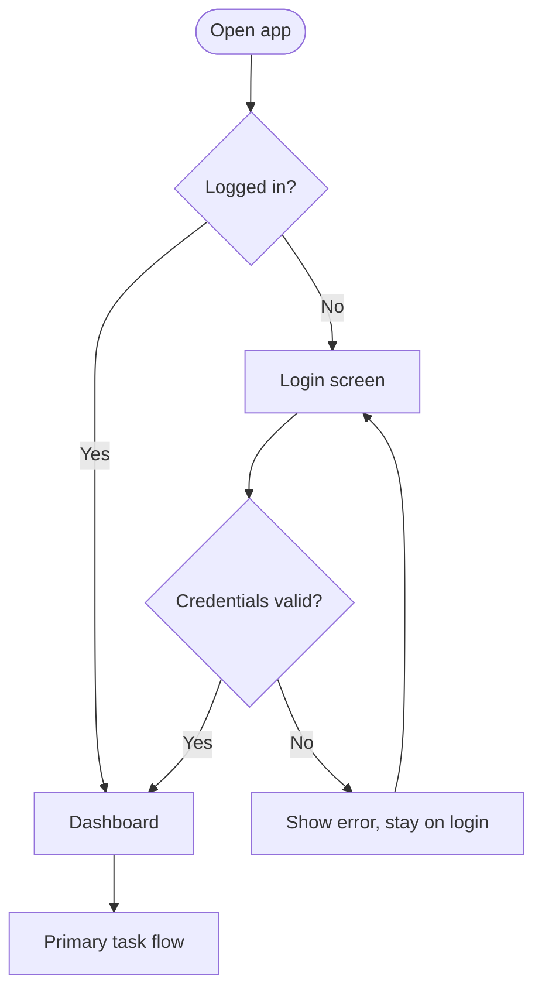

# Flow Diagrams

A flow diagram (user flow or task flow) is the key artifact of the organizing-the-app phase. It's the shared map for designers, engineers, and PMs: **screens are nodes, actions are arrows, decision points branch, and alternate/recovery paths are shown explicitly.** Produce one whenever a feature involves more than two or three screens or any branching.

## What goes in it

- **Nodes** = screens or states (e.g., "Login", "Dashboard (empty)", "Add item form").
- **Arrows** = user actions or system transitions, labeled with the trigger ("taps Save", "submit succeeds").
- **Decision points** = branches where the path forks (diamond shapes), e.g., "Logged in?" → yes / no.
- **Alternate & recovery paths** = error states, validation failures, "back" routes — so no node is a dead end.
- **Entry points** = where users can arrive (deep link, notification, direct URL), not just the front door.

Keep it to one user goal per diagram. Map the happy path first as a clear spine, then attach branches.

## How to render it

Default to a **visual diagram artifact** so the user can actually see the map. Two good options depending on context:

1. **Inline visual (preferred for chat).** Use the visualization tool to render a flowchart — nodes, labeled arrows, diamond decision points, distinct styling for error/recovery paths. This is the right call when the user asked to "see," "show," "sketch," or "diagram" a flow. Load the `diagram` module first.

2. **Mermaid** when the user wants something they can paste into docs/markdown or version-control. Use `flowchart TD` (top-down) or `LR` (left-right). Example shape:

Notes on rendering well:
- Stadium/rounded nodes `([ ])` for entry/exit, rectangles `[ ]` for screens, diamonds `{ }` for decisions.
- Label every arrow with the action or condition.
- Give error/recovery edges a visually distinct treatment (color or dashed) so they read as the exception path.
- One primary action per screen should be visible in the spine of the diagram.

## Connecting the diagram to the build

Once the flow is agreed, it maps directly onto the Django implementation:
- Each **node** → a template (often extending `base.html`) or a state-partial returned by a view.
- Each **arrow** → a URL/view transition, or an HTMX swap for in-page transitions.
- Each **decision point** → view logic / conditionals.
- Each **error/recovery path** → an error-state partial swapped into the target (`hx-target`).

So the flow diagram isn't throwaway — it's the spec the templates and views are built against in the implementation phase.
