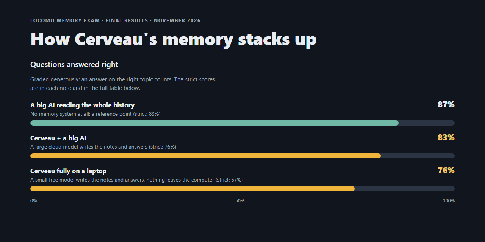

# Cerveau

[](https://github.com/Sirgogo95/cerveau-memory/actions/workflows/tests.yml) [](LICENSE)

**Long-term memory for a local LLM, on a laptop.** One continuous conversation that remembers what you told it weeks ago: after each conversation, Cerveau writes itself summaries and facts, and when you ask something later, it brings back the few memories that matter. Fully local by default: a small model (gemma4:e4b, about 4B effective parameters) on a 6 GB GPU, nothing leaves your computer.

<!-- Screenshot or short GIF here, once taken: the chat recalling something from an earlier conversation, then the memory viewer. -->

## Results



Measured on [LoCoMo](https://arxiv.org/abs/2402.17753), a widely used long-term memory benchmark: all 1,536 gradable questions, plus 446 trick questions about things never said. Graded by deepseek-v4-pro, the trick-question column included; "generous" counts an answer on the right topic, as published scores usually do. A human review of the grades gave 66.3% strict and 90.7% on trick questions for the fully local run, 76.4% and 84.8% for the cloud one.

| Setup | Strict | Generous | Trick questions |
|---|---|---|---|
| **Fully local**: gemma4:e4b writes and reads the memory (6 GB GPU) | **66.9%** | 76.4% | 83% |
| Cloud: gpt-oss:120b writes and reads the memory | 76.2% | 82.6% | 79% |
| Reference: gpt-oss:120b reads the whole history, no memory | 82.7% | 86.8% | 48% |

- **A small model builds memory almost as well as a big one** (about 1 point lost); the gap is in reading it.
- **Memory resists false premises**; reading the whole history doesn't (about 80% against 48% on trick questions).
- **The grader was checked by hand**: a review of 833 answers put the fully local run at 66.3%, where the grader said 66.9%.

Scores aren't comparable with other systems' published numbers, which use other judges and setups. Full method, limits and every run: [LoCoMo results](docs/CERVEAU_LOCOMO_RESULTS.md), and the [scoreboard page](docs/cerveau-scoreboard.html) the image comes from (HTML, to open locally).

### On my own chat history

25 of my ChatGPT conversations over 14 months, imported into Cerveau, then 60 questions about them: what I decided, what changed, when, and things I never said.

| Setup | Right of 60 |
|---|---|
| **Fully local** (gemma4:e4b) | **44** |
| Cloud (gpt-oss:120b) | 47 |
| No memory | 10 |

A small set from one person's history, so read it as a check, not a score. It found real faults that LoCoMo never showed (summaries written in the wrong language, the assistant's suggestions taken for my decisions, the model never searching its memory), each fixed in code; telling suggestions from decisions is still the weakest point (see Limits). Details: [personal chats eval](docs/PERSONAL_CHATS_EVAL.md).

## How it works

```text
your message ──► recall ──► prompt (recent messages + summary + memories) ──► answer
                   ▲
   episodes ──► consolidation (summaries, facts, entities, tags) ──► memory store
```

- **Episodes**: the conversation splits itself into episodes by time gaps and changes of subject.
- **Consolidation**: when an episode closes, the model writes a summary and extracts facts, people and tags, with dates made absolute.
- **Recall**: by meaning, names, exact words and activation (memories used together strengthen each other), within a token budget.
- **Search**: the model can also search its memory itself, with `search_memory` and `read_memory`.
- **You stay in control**: a memory viewer to see, edit or forget what it knows, and a purge command that really deletes.

The design in full: [ARCHITECTURE.md](docs/ARCHITECTURE.md). How the code does it: [the GUIDE](docs/GUIDE.md), a guided tour.

## Privacy

- **Everything stays on your machine in the default setup**: the chat model and the embedding model run in Ollama, memory lives in your own Postgres, and files you share are stored in a local folder.
- **What would leave it**: only what you opt into. Choosing a cloud model (a profile for gpt-oss:120b on Ollama Cloud is included) sends that model the prompts, which include the recalled memories. The optional reranker downloads its model from Hugging Face once.
- **You can see and change everything**: the memory viewer at `/memory/` shows every summary, fact, person and topic, and why a memory was recalled; you can edit, pin or forget any of it. Forgetting can be undone; `purge_memory` erases forgotten memory for good, with its audit copies and cached vectors. Database backups and copies you make are not reached.
- **No login**: the server listens on `127.0.0.1` only. Don't expose it to a network as it is.

## Speed and hardware

Measured on an RTX 3060 Laptop GPU (6 GB) with gemma4:e4b:

| What | Time |
|---|---|
| A short reply | about 2.5 s |
| With **Think first** on | first word after 4 to 6 s, about 9 s per answer |
| The first message after starting | about 30 s, while the models load |
| Consolidating a conversation (in the background) | 10 to 30 s |

Memory on the GPU: about 4.9 GB for both models (gemma4:e4b at a 16,384-token context and bge-m3), so both stay loaded on a 6 GB card. gemma4:e4b supports 128K tokens; Cerveau runs it at 16K because a larger window slows every reply even when the prompt is the same (generation on an 8K-token prompt: about 90 tokens/s at 16K, 55 at 32K, 44 at 64K), and memory only needs 8,000 tokens of it.

## Requirements

<!-- Check each line against a clean install. -->
- Python 3.12+
- Docker (for Postgres 17 with pgvector)
- [Ollama](https://ollama.com)
- A GPU with 6 GB of memory (tested on an NVIDIA RTX 3060 Laptop GPU), and disk space for the two models
- Tested on Windows 11; Linux and macOS should work, reports welcome

## Quick start

<!-- Replace with the exact commands from the clean-install test. -->
```bash
git clone https://github.com/Sirgogo95/cerveau-memory.git
cd cerveau-memory

# Database: Postgres 17 with pgvector
docker compose up -d

# Models
ollama pull gemma4:e4b
ollama pull bge-m3

# App
python -m venv .venv
source .venv/bin/activate        # Windows: .venv\Scripts\activate
pip install -r requirements.txt
cp .env.example .env
python manage.py migrate
python manage.py runserver

# In a second terminal (same folder, venv active): background jobs, which
# consolidate each conversation once it ends
python manage.py db_worker
```

Open http://localhost:8000 to chat, and http://localhost:8000/memory/ to see what it remembers.

## Useful commands

| Command | What it does |
|---|---|
| `python manage.py import_chats --source chatgpt path/to/export --dry-run` | Import a ChatGPT export (its unzipped folder), so memory doesn't start empty |
| `python manage.py purge_memory --dry-run` | Permanently erase forgotten memories |
| `python manage.py test` | Run the tests |
| `python -m evals.locomo --help` | Reproduce the LoCoMo runs (the runner downloads the dataset) |

Configuration (models, thresholds, budgets) lives in `configs/`: see [the GUIDE](docs/GUIDE.md).

## Limits

- **The small model is the bottleneck.** On the same memory, a 120B model answers about 8 points better, mostly on questions that combine several memories.
- **Small models confuse suggestions with decisions**: asked "did I decide X?", they tend to say yes when the assistant only suggested it.
- **Pushing a small model to try harder makes it invent.** Thinking mode and prompt nudges both lowered trick-question scores, so thinking is an opt-in switch.
- **One user, one machine.** No accounts or multi-user support yet.
- LoCoMo is two friends chatting, not one person with an assistant; my own chat eval is 60 questions on one person's history.

## FAQ

**Why not just put the whole history in the model's context?** Two reasons. On a laptop it doesn't fit: gemma4:e4b supports 128K tokens (Cerveau runs it at 16K, see Speed and hardware), and a year of conversations is far more than 128K. And where it does fit, it fails differently: on LoCoMo, a 120B model reading the whole history scored higher on normal questions (82.7%), but went along with false premises half the time (48% right on trick questions, against about 80% with Cerveau's memory).

**How is this different from ChatGPT's memory?** It runs on your machine, you can see every memory and why it was recalled, edit it and really delete it, it works with whichever model you plug in, and it's measured in the open, with the method and the misses published.

**Can I use a bigger or different model?** Any model Ollama serves, by adding a profile in `configs/models/` (its context window, reply reserve, and whether it supports tools); a 120B cloud model profile is included as an example. Other providers are on the roadmap.

**Which languages?** English, Spanish and French are tested: the embedding model (bge-m3) is multilingual, a question in one language usually finds memories written in another (some words don't cross, like "best man" and *padrino*), and Cerveau replies in the language you write in.

**Do I need a GPU?** It was built and measured on a 6 GB laptop GPU. Ollama also runs on a CPU alone, but expect much slower replies.

## Roadmap

Ideas for what comes next, not commitments. The full list, with what's already built, is in [ARCHITECTURE.md](docs/ARCHITECTURE.md#roadmap).

- **More model providers.** Today the chat model runs through Ollama, locally or on Ollama Cloud. Next: any OpenAI-compatible server, which covers OpenAI itself, LM Studio, llama.cpp's server and vLLM; and the Claude API. The memory stays local whichever model answers. That would also open [colibri](https://github.com/JustVugg/colibri), which serves very large mixture-of-experts models from disk on modest hardware through an OpenAI-compatible API: slow, but a possible pairing for background consolidation (untested).
- **More importers.** ChatGPT exports are supported; a Claude export importer is next, so memory can start from either history.
- **Voice, with [Pipecat](https://github.com/pipecat-ai/pipecat).** Pipecat is an open-source framework for real-time voice agents; memory plugs in as a processor before the model, as its existing memory integrations do. Cerveau as that processor would give a voice assistant a long-term memory that stays on your machine, storing transcripts, not audio.
- **Memory for other assistants**, through an MCP server: other tools could search and add to the same memory.
- **Better answering on a small model**: the 8-point gap with a 120B model, mostly on questions that combine several memories, and telling suggestions from decisions.
- **Accounts**: more than one user on one server.

## Related work

Cerveau was designed from how human memory works, and recent research has converged on several of the same mechanisms:

- **[SYNAPSE](https://arxiv.org/abs/2601.02744)** (Jiang et al., Findings of ACL 2026): an episodic-semantic memory graph with spreading activation and lateral inhibition, evaluated on LoCoMo. Cerveau's activation borrows from it openly.
- **[HeLa-Mem](https://arxiv.org/abs/2604.16839)** (Zhu et al., ACL 2026): Hebbian association and reflective consolidation into semantic memory.
- **[MemGPT](https://arxiv.org/abs/2310.08560) / Letta** (Packer et al., 2023): the context window treated like RAM, with memory paged in and out.
- **[Generative Agents](https://arxiv.org/abs/2304.03442)** (Park et al., 2023): memory streams scored by recency, importance and relevance, with periodic reflection.
- **[Mem0](https://arxiv.org/abs/2504.19413)** (Chhikara et al., 2025) and **[Zep](https://arxiv.org/abs/2501.13956)** (Rasmussen et al., 2025): memory layers for developers, both reporting LoCoMo scores ([why they aren't compared here](docs/CERVEAU_LOCOMO_RESULTS.md)).
- **[LoCoMo](https://arxiv.org/abs/2402.17753)** (Maharana et al., 2024): the benchmark used here.
- **Cognitive science**: spreading activation (Collins and Loftus, 1975) and the fan effect from ACT-R (Anderson, 1983).

What's different here: one continuous conversation split into episodes automatically, rather than retrieval over separate sessions; activation carried across turns, deciding what stays in mind; a tag and entity layer you can browse and correct; and a self-hosted assistant measured end to end on a laptop, not a developer SDK. More in [ARCHITECTURE.md](docs/ARCHITECTURE.md#related-work).

## Docs

[The docs index](docs/README.md): results, how it works, and the development log.

## Built with

Designed and evaluated by me, implemented with Claude Code as a coding assistant. The design decisions, the evaluation rules and the human review of the grades are mine.

## License

MIT. See [LICENSE](LICENSE). Vendored fonts are under the OFL, marked under MIT, and DOMPurify under Apache-2.0 or MPL-2.0. LoCoMo (Maharana et al., 2024) is not included: the runner downloads it under that dataset's own license.
