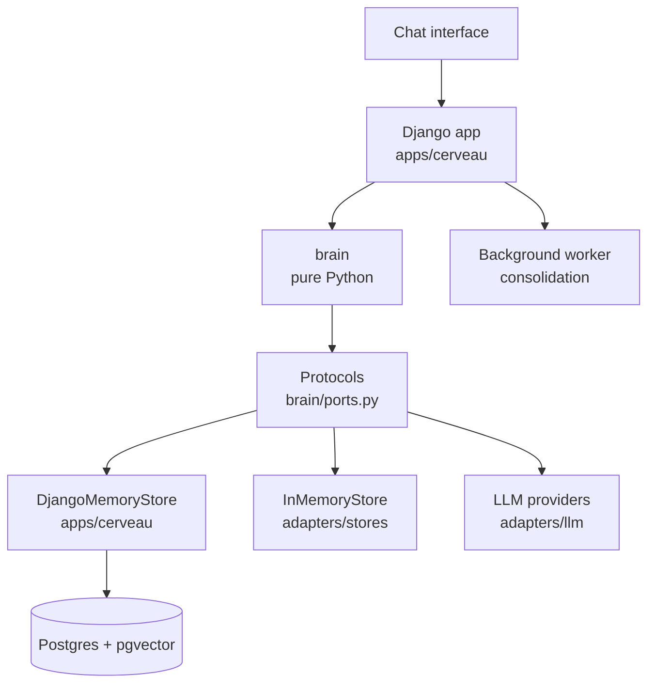
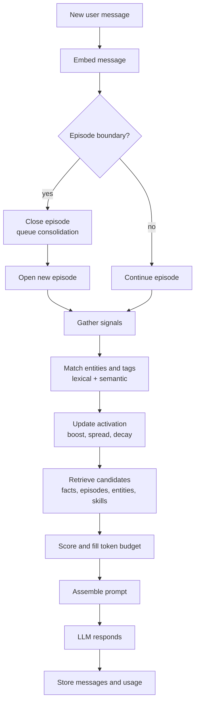

# Cerveau: the architecture

> *Cerveau* (French): brain.

**A brain-inspired memory system for AI assistants. One continuous conversation, instead of many disconnected chats, where the AI decides for itself what to remember, what to keep in mind, and what to let fade.**

Cerveau is model-agnostic: the memory lives in your own Postgres database, and any sufficiently capable LLM can sit on top of it. Your memory is yours, inspectable, editable, and portable across models.

This is the design in full, kept from when it was the project's README (until 2026-11-10). The short introduction, the results and the quick start are in the [README](../README.md); where each part stands is in [STATUS.md](STATUS.md); how the code does it, in the [GUIDE](GUIDE.md).

---

## Table of contents

- [The problem](#the-problem)
- [The idea](#the-idea)
- [How it maps to the brain](#how-it-maps-to-the-brain)
- [Architecture](#architecture)
- [Memory model](#memory-model)
- [What happens on each message](#what-happens-on-each-message)
- [Consolidation: the sleep cycle](#consolidation-the-sleep-cycle)
- [Episodes and segmentation](#episodes-and-segmentation)
- [Facts](#facts)
- [Entities](#entities)
- [The tag graph](#the-tag-graph)
- [Activation](#activation)
- [The retrieval engine](#the-retrieval-engine)
- [Prompt assembly and token budgets](#prompt-assembly-and-token-budgets)
- [Embeddings](#embeddings)
- [Caching](#caching)
- [Database schema](#database-schema)
- [Project structure](#project-structure)
- [Development setup](#development-setup)
- [Tech stack](#tech-stack)
- [Configuration](#configuration)
- [Evaluation](#evaluation)
- [Roadmap](#roadmap)
- [Design principles](#design-principles)
- [Privacy](#privacy)
- [Related work](#related-work)
- [Contributing](#contributing)
- [License](#license)

---

## The problem

Today's AI chat tools force a choice:

- **Many separate chats.** Each one starts from zero, so you re-explain your projects, preferences, and context over and over.
- **One giant chat.** The full history gets resent on every turn, costs grow without bound, and the model quietly loses track of older details.

Built-in memory features help a little, but they are tied to one provider, opaque about what they stored and why, and hard to correct.

## The idea

Your brain doesn't open a new "chat" for every topic. You have **one continuous stream of experience**, and the right memories surface on their own when they become relevant, while everything else stays dormant until needed.

Cerveau gives an AI the same structure:

- **One conversation**, automatically split into **episodes** as topics change.
- A **long-term memory** of episodes, facts, entities, and topics in Postgres.
- A **working memory** (the prompt) with a strict token budget, filled each turn with whatever is most relevant right now.
- **Activation** that spreads through associations, so mentioning one thing warms up related things, and fades when they stop being relevant.
- A **consolidation** step, the equivalent of sleep, that turns raw conversations into durable knowledge.

## How it maps to the brain

| Brain | Cerveau |
|---|---|
| Working memory (small capacity) | Prompt with a per-model token budget |
| Attention | Activation scores deciding what gets loaded |
| Hippocampus (episodic memory) | Episodes and messages, indexed by embeddings |
| Neocortex (semantic memory) | Facts, entities, and the tag graph |
| Associations | Tag edges learned from co-occurrence |
| Priming | Prefetching related memories into the cache (planned, not built) |
| Event segmentation | Automatic episode boundaries |
| Sleep consolidation | Summaries, fact and entity extraction at episode close |
| Forgetting | Activation fades over turns and hours; memories themselves are kept until you forget them |
| Retrieval strengthens memory | Facts reinforced each time they are used (planned, not built: [NEXT_FEATURES.md](NEXT_FEATURES.md) 9) |
| Procedural memory | Skills, loaded on demand |
| Gist vs detail | Short and long summaries, raw messages only when needed |

Where the analogy is deliberately broken: human recall is reconstructive and error-prone. Cerveau always keeps the original messages, so summaries and facts can be checked against their source.

## Architecture

Cerveau is layered so the "brain" never depends on the framework around it.



- **`brain/`**: the algorithms (activation, segmentation, scoring, prompt assembly) and every contract the engine depends on. Plain Python, no framework or SDK imports, fully unit-testable.
- **Protocols** (`brain/ports.py`): what the core needs from the outside world, both storage ("load the subgraph around these anchors") and LLMs (`ChatProvider`). The core only ever calls these.
- **`adapters/`**: pure-Python implementations of those Protocols, with no Django. `adapters/llm/` holds one `ChatProvider` per provider; `adapters/stores/` holds `InMemoryStore`, which uses plain dictionaries for fast tests and benchmark runs. Evals can use both without starting Django.
- **`apps/cerveau/`**: the single Django app wrapping the brain: models, `DjangoMemoryStore` (the Protocols implemented with the ORM), admin (the memory inspector), chat views and streaming, background jobs.

This is the same pattern Django uses for database backends: one contract, one implementation per provider. Swapping Django for another framework later means writing one new store, not rewriting the brain.

## Memory model

| Concept | What it is | Example |
|---|---|---|
| **Message** | A single turn, user or assistant | "Let's use Postgres for this" |
| **Episode** | A segment of the conversation about one topic | "Designing the Cerveau schema" |
| **Tag** | A topic, broad and reusable | `programming`, `travel`, `health` |
| **Entity** | A specific named thing | a person, a project, a place, a product |
| **Fact** | A durable, self-contained statement | "The Cerveau project uses Postgres" |
| **Skill** | A procedure with a description and a file | "How to write release notes" |
| **Activation** | How "in mind" a node is right now | `programming: 0.82` |

Rule of thumb for tags vs entities: **topics are tags, specific named things are entities.**

## What happens on each message



1. **Embed** the new message (cached by hash).
2. **Check the episode boundary** (time gap or topic drift).
3. **Gather signals** once: query embedding, matched entities, matched tags.
4. **Update activation**: boost matched nodes, spread to neighbors, decay everything else.
5. **Retrieve and score** candidates from every memory source with one shared engine.
6. **Fill the token budget** for the current model.
7. **Assemble the prompt** and call the model.
8. **Record** which memories were actually used, to reinforce them later (planned, not built).

## Consolidation: the sleep cycle

When an episode closes, a background job processes it, using a small, cheap model rather than the main one:

1. Write a **short summary** (one or two sentences) and a **long summary**.
2. Assign **tags**, reusing existing ones (checked by name and embedding similarity before creating new ones).
3. Extract **entities** and **facts**.
4. **Deduplicate** facts and detect contradictions.
5. Update **tag edge weights** from co-occurrence.
6. Link the episode to related earlier episodes.

**As built:** steps 1 to 4 run as described, with dates made absolute and the summary language set in code (GUIDE 4.11). Steps 5 and 6 don't exist as separate steps: links between tags and people are computed from the episodes they share whenever activation needs them, not stored (`brain/activation.py`), and episodes aren't linked to each other.

Consolidation never blocks the chat.

## Episodes and segmentation

An episode closes when either:

- **Time gap**: no messages for a configurable period (default: 2 hours).
- **Topic drift**: the new message's embedding is far from the recent context of the episode.

Drift detection details:

- Compare against the **average of the last ~5 messages**, not the whole episode, since conversations naturally wander.
- **Skip short messages** ("ok", "yes", "do it"); their embeddings carry little meaning.
- **Two-strike rule**: require two consecutive drifting messages before splitting, so a one-off tangent doesn't cut the thread. In the gray zone, a cheap LLM call confirms the shift.
- **Returning to an old topic** starts a new episode **linked** to the old one, keeping the timeline honest while still letting retrieval pull the earlier episode in.
- **Carry-over**: the last few messages of the previous episode stay in the prompt for a couple of turns after a split, decaying out.

**As built** (`brain/segmentation.py`, GUIDE 4.7): a time gap of 2 hours starts a new episode. For drift, a message is a strike when its similarity to the average of the **last 2 messages** is below 0.48, and two strikes in a row split the episode at the first of them; messages under 5 words, and episodes with fewer than 3 messages from you, never count. The gray-zone model check isn't built, and episodes aren't linked: returning to an old topic starts a new episode, and recall finds the old one by meaning. An episode that just closed and isn't summarized yet appears in the prompt through its last messages.

## Facts

A fact must pass three tests:

1. **Durable**: still true beyond this episode.
2. **Self-contained**: understandable read cold.
3. **Useful**: knowing it would change a future answer.

Not facts: questions, hypotheticals, options considered but not chosen, and the assistant's own suggestions unless the user accepted them.

**Extraction** happens at consolidation, with structured output:

```json
{
  "facts": [
    {
      "statement": "The Cerveau project stores memory in Postgres",
      "type": "project_state",
      "source": "user_stated",
      "confidence": 0.95,
      "tags": ["cerveau", "databases"],
      "source_message_ids": [412, 415]
    }
  ]
}
```

`source` separates `user_stated` from `inferred`; inferred facts get lower confidence.

**Deduplication** against existing facts by embedding similarity (thresholds are starting points, calibrated per embedding model):

| Similarity | Action |
|---|---|
| above 0.92 | Same fact: increment `times_confirmed` |
| 0.75 to 0.92 | Ask the LLM: duplicate, update, contradiction, or distinct |
| below 0.75 | New fact |

Facts are **never deleted** on update. The old fact is marked `superseded_by` the new one, preserving history and making errors debuggable.

**As built** (see [docs/FACTS.md](FACTS.md)): with bge-m3, updates can score as high as rewordings (0.96 vs 0.92), so similarity only narrows the candidates: 0.97 and above is the same fact, 0.55 to 0.97 goes to the model, which decides. Only facts the user stated are kept for now.

## Entities

Embeddings blur exact names, so specific things get their own path:

- Extracted at consolidation, with a type and aliases ("my dad", nicknames).
- **Matched at query time with plain text search**, which is instant and free.
- `pg_trgm` handles fuzzy matches and typos; `unaccent` makes "José" match "Jose", important for multilingual use.
- Entities join the activation graph as **bridge nodes**, connecting topics that never appear together in the same message.

## The tag graph

Tags form a weighted, undirected graph:

- An optional `parent_id` provides a clean hierarchy where one exists.
- **Edges carry association strength**, learned from data rather than guessed: each time an episode closes, every pair of its tags gets a co-occurrence increment, and weights are normalized with Jaccard similarity:

```
weight(A, B) = episodes with both A and B / episodes with A or B
```

The graph builds itself from how you actually talk: things experienced together become linked.

## Activation

Activation decides what is "in mind." It lives in a table, persists across turns, and decays over both turns and elapsed time.

Each turn, the cycle runs a few iterations of:

**1. Spread with the fan effect.** A node keeps part of its energy and receives energy from its neighbors. Each neighbor's contribution is divided by its number of connections, so broad hubs like `tech` can't flood everything.

```
new_energy(i) = (1 - decay) * energy(i)
              + sum over neighbors j of: spread * weight(j, i) * energy(j) / connections(j)
```

```python
def spread(i, a, neighbors, weight, fan, S=0.8, delta=0.5):
    kept = (1 - delta) * a[i]
    received = sum(S * weight[j][i] * a[j] / fan[j] for j in neighbors[i])
    return kept + received
```

**2. Lateral inhibition** (optional, light). The strongest nodes suppress weaker competitors, pushing noise toward zero. Too strong, and small but correct details get suppressed ("cognitive tunneling"), so it is tuned conservatively.

```python
def inhibit(i, u, top_nodes, beta=0.15):
    penalty = sum(u[k] - u[i] for k in top_nodes if u[k] > u[i])
    return max(0, u[i] - beta * penalty)
```

**3. Squash** into a 0 to 1 range with a sigmoid, acting as a soft on/off switch.

```python
def sigmoid(x, gamma=5.0, theta=0.5):
    return 1 / (1 + math.exp(-gamma * (x - theta)))
```

**Confidence gate** (designed, not built). If the top activation is below a threshold, the assistant says it has no record of something rather than guessing. This is the main defense against confidently recalling things that never happened.

Default values above are taken from SYNAPSE (see [Related work](#related-work)) as starting points; what was built and tuned on Cerveau's own evaluations follows.

**As built** (`brain/activation.py`, GUIDE 4.18; the design above is kept as its history): nodes are tags and people. Each turn every node fades (keeping 70%, and halving every 6 hours), the ones the message names or is about are boosted, and half of that boost spreads one hop to the nodes that share episodes with them, weighted by how often (Jaccard) and divided by the node's number of neighbours (the fan effect). Energy spreads only from nodes boosted this turn, values are capped at 1 instead of passed through a sigmoid, and the links are computed when needed, not kept in a table. In scoring, a memory whose episode carries an active node gets a small boost (`w_act` 0.05). Lateral inhibition exists in retrieval but is off by default (`inhibition = 0`). There is no confidence gate: invented details were fixed by a prompt rule instead (see the roadmap).

## The retrieval engine

Facts, episodes, entities, and skills all go through **one pipeline**: find candidates, score them, fill the budget. Every difference between sources is configuration.

Signals gathered once per message:

- **Semantic**: cosine similarity to the query embedding.
- **Lexical**: exact and fuzzy text matches, entity names.
- **Activation**: current energy of the node and its tags.

```python
def retrieve(query, store, config, budget):
    signals = gather_signals(query, store)
    results = {}
    for name, src in config.sources().items():
        if not src.enabled:
            continue
        candidates = store.candidates(name, signals)
        scored = [score(c, signals, src) for c in candidates]
        kept = [c for c in scored if c.score >= src.min_score]
        results[name] = fill(kept[:src.max_items], budget * src.budget_share)
    return results
```

**Skills** use the same engine with stricter settings: only skill descriptions are scored, with a high threshold, and a skill's full file loads only when its description crosses that threshold or the model requests it.

Multi-tag queries support both modes: **any** of the tags, or **all** of them.

## Prompt assembly and token budgets

The cache can hold plenty; the **prompt** is working memory and gets a strict budget per model.

```python
@dataclass
class ModelProfile:
    name: str
    context_window: int
    output_reserve: int
    memory_budget: int
```

`memory_budget` is set well below the model's maximum. Long prompts cost more, run slower, and models tend to use information buried in the middle of very long contexts less reliably. Good selection beats volume.

Prompt order: what stays the same from turn to turn first, what changes every turn last.

1. System prompt, with today's date and the most recent conversations (titles and short summaries, always present)
2. Current episode running summary
3. Pinned messages
4. Recent messages of the current episode, verbatim
5. Retrieved memory for this turn: facts, episode summaries, entities, loaded skills, and the confidence-gate note if any
6. The new user message

Providers and local runtimes such as Ollama reuse their work for a prompt prefix identical to the previous call's. Retrieved memory changes every turn, so it goes after the conversation: everything before it stays cacheable, and the memories sit right next to the question they were retrieved for.

The **current episode is always present**. It has a guaranteed share of the budget and works as a rolling window: recent messages verbatim plus a running summary of the earlier part. The window moves in chunks (about ten messages folded into the summary at once), so the prompt prefix stays identical for several turns. Important messages (decisions, pasted code, stated constraints) can be **pinned** so they survive the window.

The full step-by-step flow is in [PIPELINE.md](PIPELINE.md).

Each episode stores a **short and a long summary**, so the same memory degrades gracefully from large frontier models to small local ones.

Tokens are counted with the provider's tokenizer when available, otherwise approximated (characters ÷ 4) with a safety margin.

## Embeddings

An embedding is a list of numbers (coordinates) that places a piece of text in a "space of meaning," where texts with similar meaning land close together. Similarity is measured with cosine similarity.

What gets embedded: messages, episode summaries, facts, tag names (to catch near-duplicates such as `coding` vs `programming`), entity names, and skill descriptions.

Guidelines:

- **Same model for storing and querying**; vectors from different models are not comparable.
- **Vectors live in their own tables**, one per kind of memory, with the model name and a hash of the embedded text on every row. Several models can coexist, so upgrading is a background re-embed plus a config switch. See [EMBEDDINGS.md](EMBEDDINGS.md).
- **More dimensions is not automatically better.** Choose by retrieval benchmarks and tests on real data. 384 to 1024 dimensions from a strong model is plenty at personal scale. Multilingual models are worth testing early.
- **Embed focused units.** Long mixed texts blur into a meaningless average.
- **Keep lexical search alongside**; embeddings are weak at exact identifiers and negation.

Default: `bge-m3` (1024 dimensions, multilingual, reads up to 8,192 tokens), served by Ollama on the GPU, chosen over four other models on the eval set. Each model has a profile in `configs/embeddings/` with its calibrated retrieval threshold.

## Caching

Most latency and cost comes from model calls, not database lookups, so caching targets those first.

1. **Embedding cache**: `(model, text hash)` to vector. The same text always yields the same vector.
2. **Prompt prefix caching**: the conversation comes before per-turn memory, so repeated turns reuse the prefix cheaply (see [Prompt assembly](#prompt-assembly-and-token-budgets)).
3. **Working memory cache** (planned): loaded summaries and facts kept warm in memory, with eviction driven by activation decay rather than generic LRU.
4. **Priming** (planned): when a tag's activation rises, prefetch the top episodes of its neighbors.
5. **Usage as a learning signal** (planned, not built): memories that get used are reinforced; never-used ones fade in ranking (never deleted).

Cache keys include a version or `updated_at`, so rewritten summaries and superseded facts are never served stale.

## Database schema

Postgres with the `vector`, `pg_trgm`, and `unaccent` extensions. This is the target schema; v1 implements a subset (see [Roadmap](#roadmap)). Content tables hold no vectors: embeddings live in one table per kind of memory, keyed by memory and model, so several embedding models can coexist ([EMBEDDINGS.md](EMBEDDINGS.md)).

```sql
CREATE EXTENSION IF NOT EXISTS vector;
CREATE EXTENSION IF NOT EXISTS pg_trgm;
CREATE EXTENSION IF NOT EXISTS unaccent;

CREATE TABLE episodes (
    id BIGSERIAL PRIMARY KEY,
    title TEXT,
    summary_short TEXT,
    summary_long TEXT,
    importance REAL DEFAULT 0.5,
    started_at TIMESTAMPTZ DEFAULT now(),
    ended_at TIMESTAMPTZ,
    summary_updated_at TIMESTAMPTZ
);

CREATE TABLE episode_links (
    from_episode BIGINT REFERENCES episodes(id),
    to_episode BIGINT REFERENCES episodes(id),
    weight REAL,
    PRIMARY KEY (from_episode, to_episode)
);

CREATE TABLE messages (
    id BIGSERIAL PRIMARY KEY,
    episode_id BIGINT REFERENCES episodes(id),
    role TEXT CHECK (role IN ('user', 'assistant', 'tool')),
    content TEXT NOT NULL,
    pinned BOOLEAN DEFAULT false,
    created_at TIMESTAMPTZ DEFAULT now()
);

CREATE TABLE tags (
    id BIGSERIAL PRIMARY KEY,
    name TEXT UNIQUE NOT NULL,
    parent_id BIGINT REFERENCES tags(id)
);

CREATE TABLE tag_edges (
    tag_a BIGINT REFERENCES tags(id),
    tag_b BIGINT REFERENCES tags(id),
    weight REAL CHECK (weight BETWEEN 0 AND 1),
    co_occurrences INT DEFAULT 0,
    PRIMARY KEY (tag_a, tag_b),
    CHECK (tag_a < tag_b)
);

CREATE TABLE episode_tags (
    episode_id BIGINT REFERENCES episodes(id),
    tag_id BIGINT REFERENCES tags(id),
    relevance REAL,
    PRIMARY KEY (episode_id, tag_id)
);

CREATE TABLE entities (
    id BIGSERIAL PRIMARY KEY,
    name TEXT NOT NULL,
    type TEXT,
    aliases TEXT[] DEFAULT '{}'
);

CREATE TABLE entity_mentions (
    entity_id BIGINT REFERENCES entities(id),
    message_id BIGINT REFERENCES messages(id),
    episode_id BIGINT REFERENCES episodes(id),
    PRIMARY KEY (entity_id, message_id)
);

CREATE TABLE facts (
    id BIGSERIAL PRIMARY KEY,
    statement TEXT NOT NULL,
    type TEXT,
    source TEXT CHECK (source IN ('user_stated', 'inferred')),
    confidence REAL,
    source_episode_id BIGINT REFERENCES episodes(id),
    superseded_by BIGINT REFERENCES facts(id),
    times_confirmed INT DEFAULT 1,
    last_confirmed_at TIMESTAMPTZ DEFAULT now(),
    last_used_at TIMESTAMPTZ,
    created_at TIMESTAMPTZ DEFAULT now()
);

CREATE TABLE fact_tags (
    fact_id BIGINT REFERENCES facts(id),
    tag_id BIGINT REFERENCES tags(id),
    PRIMARY KEY (fact_id, tag_id)
);

CREATE TABLE skills (
    id BIGSERIAL PRIMARY KEY,
    name TEXT UNIQUE NOT NULL,
    description TEXT,
    file_path TEXT
);

CREATE TABLE activation (
    node_type TEXT CHECK (node_type IN ('tag', 'entity', 'episode', 'fact')),
    node_id BIGINT,
    value REAL DEFAULT 0,
    updated_at TIMESTAMPTZ DEFAULT now(),
    PRIMARY KEY (node_type, node_id)
);

-- Embeddings: one table per kind, unsized VECTOR so models of any dimension
-- coexist; every query filters on model. CASCADE means purging a memory removes
-- its vectors for every model.
CREATE TABLE message_embeddings (
    message_id BIGINT REFERENCES messages(id) ON DELETE CASCADE,
    model TEXT NOT NULL,
    embedding VECTOR NOT NULL,
    text_hash TEXT NOT NULL,
    created_at TIMESTAMPTZ DEFAULT now(),
    PRIMARY KEY (message_id, model)
);
-- fact_embeddings, entity_embeddings, tag_embeddings, skill_embeddings:
-- same shape, each with a foreign key to its own table.

CREATE TABLE episode_embeddings (
    episode_id BIGINT REFERENCES episodes(id) ON DELETE CASCADE,
    model TEXT NOT NULL,
    summary_short VECTOR,
    summary_short_hash TEXT,
    summary_long VECTOR,
    summary_long_hash TEXT,
    updated_at TIMESTAMPTZ DEFAULT now(),
    PRIMARY KEY (episode_id, model)
);

CREATE TABLE embedding_cache (
    model TEXT NOT NULL,
    text_hash TEXT NOT NULL,
    embedding VECTOR NOT NULL,
    PRIMARY KEY (model, text_hash)
);

CREATE INDEX ON entities USING gin (name gin_trgm_ops);
-- No vector indexes in v1 (sequential scans are fast at personal scale). Later:
-- a partial HNSW index per model on a cast expression, see EMBEDDINGS.md.
```

Active facts are `WHERE superseded_by IS NULL`.

## Project structure

```
cerveau/
├── core/               # Django project: settings, environments (base template)
├── kernel/             # base template: SoftDeleteModel, audit trail, middleware
├── brain/              # pure Python, no framework or SDK imports
│   ├── types.py        # dataclasses: Episode, Message, Candidate, Embedding...
│   ├── ports.py        # all Protocols: MemoryStore (episodes, messages, tags, entities, search, cache), Embedder, ChatProvider
│   ├── turn.py         # run_turn: one turn of the pipeline, step by step
│   ├── segmentation.py # episode boundary detection
│   ├── embedding.py    # embed_cached: embedding through the cache
│   ├── retrieval.py    # candidates, scoring, thresholds
│   ├── prompt.py       # prompt assembly, memory block, token estimation
│   ├── activation.py   # spread, inhibit, sigmoid, decay
│   ├── hashing.py      # text_hash, shared by the cache and embedding tables
│   └── config.py       # EngineConfig, SourceConfig, ModelProfile, loaders
├── adapters/           # pure-Python implementations of brain's Protocols, no Django
│   ├── llm/            # one ChatProvider per provider (anthropic, openai, ollama...)
│   ├── embeddings/     # Embedder implementations (Ollama; sentence-transformers on the CPU)
│   └── stores/
│       └── in_memory.py  # InMemoryStore for tests and evals
├── apps/
│   └── cerveau/        # the single Django app wrapping the brain
│       ├── models/     # package: episodes, messages, facts, tags, entities...
│       ├── store.py    # DjangoMemoryStore, the ORM implementation of the store Protocols
│       ├── tasks.py    # consolidation: summaries, facts, entities, edges
│       ├── views/      # chat UI, streaming
│       ├── admin.py    # the memory inspector
│       ├── templates/cerveau/
│       └── static/cerveau/
├── evals/              # LoCoMo runner, personal eval set
├── configs/            # engine presets per model
└── tests/
```

Dependency rule:

- `brain/` imports nothing from `adapters/`, `apps/`, `kernel/`, or Django.
- `adapters/` imports `brain/` only.
- `apps/cerveau/` may import `brain/`, `adapters/`, and `kernel/`.

One Django app is enough because nothing in it is independently reusable: chat, memory, and consolidation all exist to wrap `brain/`. Structure inside the app comes from modules, not from more apps. (The root `adapters/` package is unrelated to `kernel/base_app/adapters.py`, which holds allauth adapters.)

Further docs: [GUIDE.md](GUIDE.md) (a guided tour of all the code, with examples), [STATUS.md](STATUS.md) (what is implemented so far), [CERVEAU_LOCOMO_RESULTS.md](CERVEAU_LOCOMO_RESULTS.md) (every LoCoMo run), [PERSONAL_CHATS_EVAL.md](PERSONAL_CHATS_EVAL.md) (the eval on real chats), [PIPELINE.md](PIPELINE.md) (each step of a turn, by phase), [EMBEDDINGS.md](EMBEDDINGS.md) (embedding storage), [SEARCH_MEMORY_TOOL.md](SEARCH_MEMORY_TOOL.md) (deliberate recall, v2), [ATTACHMENTS.md](ATTACHMENTS.md) (sharing files), [DJANGO_SETUP.md](DJANGO_SETUP.md) (how Cerveau maps onto the Django template), [base_django_setup.md](base_django_setup.md) (the template reference), [github_workflow.md](github_workflow.md) (mandatory git rules).

## Development setup

Requirements: Python 3.12+, Docker, and [Ollama](https://ollama.com) for a local model.

**1. Postgres with pgvector.** The official image ships pgvector; `pg_trgm` and `unaccent` come with Postgres itself. The named volume keeps memory across container restarts.

```bash
docker run -d --name cerveau-pg --restart unless-stopped \
  -e POSTGRES_USER=cerveau -e POSTGRES_PASSWORD=cerveau -e POSTGRES_DB=cerveau \
  -p 5432:5432 -v cerveau-pgdata:/var/lib/postgresql/data \
  pgvector/pgvector:pg17

# Separate database for the eval environment (benchmarks never touch real memory)
docker exec cerveau-pg createdb -U cerveau cerveau_eval
```

`--restart unless-stopped` brings Postgres back whenever Docker starts; enabling "Start Docker Desktop when you sign in" in Docker Desktop's settings then makes it fully automatic. Manual control: `docker start cerveau-pg` / `docker stop cerveau-pg`. The `cerveau` user is a superuser, which the first migration needs to enable the extensions.

**2. Python environment.**

```bash
python -m venv .venv
.venv\Scripts\activate            # Windows
# source .venv/bin/activate       # macOS / Linux
pip install -r requirements-dev.txt   # the app plus type-checking tools (requirements.txt for the app alone)
# pip install -r requirements-optional.txt   # only for the reranker or the CPU embedding profile (PyTorch, about 1 GB)
cp .env.example .env              # its DATABASE_URL__* values match the Docker command above
```

**3. Migrate (once, and after pulling new migrations).**

```bash
python manage.py migrate                      # dev database
DJANGO_ENV=eval python manage.py migrate      # eval database (bash; in PowerShell: $env:DJANGO_ENV="eval")
python manage.py createsuperuser              # once: your login for /admin/
```

**4. Local models.** Pull the chat model and the embedding model the default profiles use: `ollama pull gemma4:e4b` and `ollama pull bge-m3` (or set `CERVEAU_CHAT_MODEL` and `CERVEAU_EMBEDDING_MODEL` in `.env` to other profiles in `configs/models/` and `configs/embeddings/`).

**5. Run Cerveau.** Docker Desktop and Ollama must be running. Then, in two terminals (each with the virtual environment active):

```bash
# Terminal 1: the web server
python manage.py runserver                    # chat at http://localhost:8000/, admin at /admin/

# Terminal 2: the background worker
python manage.py db_worker                    # runs background jobs: consolidation of closed episodes
```

The web server loads the embedding and chat models in the background at startup and queues any episode waiting for consolidation. The worker picks jobs up from Postgres and runs them; it reloads on code changes while `DEBUG` is on. Without it, chatting still works, but closed episodes stay unconsolidated (no summaries, tags, or entities) until a worker runs.

Background job commands:

| Command | What it does |
|---|---|
| `python manage.py db_worker` | Runs queued jobs continuously (checks every second) |
| `python manage.py db_worker --batch` | Runs everything queued, then exits |
| `python manage.py consolidate` | Consolidates pending episodes right here, no worker needed (`--episode 12`, `--force` to redo, `--queue` to hand them to the worker) |
| `python manage.py prune_db_task_results` | Deletes old finished job records |

For the eval environment, prefix any of them with `DJANGO_ENV=eval` (in PowerShell, set `$env:DJANGO_ENV="eval"` first); the eval server runs on port 8010.

To talk to the model from Python instead of the chat page:

```python
from adapters.llm.factory import provider_from_profile
from brain.config import load_model_profile
from brain.types import ChatMessage, Role

llm = provider_from_profile(load_model_profile("configs/models/gemma4-e4b.toml"))
print(llm.chat([ChatMessage(Role.USER, "Hello")]).content)
```

**Tests.** `python manage.py test` runs everything (it creates a throwaway Postgres test database). Tests for `brain/` and `adapters/` need no database: `python -m unittest discover -s tests -t .`

## Tech stack

| Layer | Choice | Why |
|---|---|---|
| Language | Python | Ecosystem for embeddings and LLM tooling |
| Web framework | Django | Fast to build, ORM and migrations, admin as memory inspector |
| Database | Postgres | Relational data, graph via adjacency lists and recursive CTEs |
| Vector search | pgvector | Embeddings inside the same database, HNSW indexes |
| Text matching | pg_trgm, unaccent | Fuzzy and accent-insensitive entity matching |
| Embeddings | bge-m3 on Ollama (local) | Free, private, multilingual, swappable |
| Background jobs | Django's tasks with django-tasks-db (a queue in Postgres, run by `python manage.py db_worker`) | Consolidation outside the request cycle |
| LLM | Any capable provider or local model | Model-agnostic by design |

## Configuration

Retrieval and activation are fully driven by configuration, so experiments are reproducible and per-model presets are easy.

The configuration as built is in [configs/default.toml](../configs/default.toml) (the engine), `configs/models/` (one file per chat model) and `configs/embeddings/` (one per embedding model, with its calibrated thresholds); [GUIDE section 8](GUIDE.md) explains every value. The sketch below is the original design: some names and defaults changed, and `confidence_gate` was never built.

```python
@dataclass
class SourceConfig:
    enabled: bool = True
    w_semantic: float = 0.5
    w_lexical: float = 0.4
    w_activation: float = 0.3
    min_score: float = 0.2
    budget_share: float = 0.3
    max_items: int = 10

@dataclass
class EngineConfig:
    facts: SourceConfig
    episodes: SourceConfig
    entities: SourceConfig
    skills: SourceConfig
    spread_factor: float = 0.8
    decay: float = 0.5
    inhibition: float = 0.15
    confidence_gate: float = 0.12
    episode_gap_hours: float = 2.0
```

## Evaluation

Claims get measured, not asserted.

**1. LoCoMo benchmark.** LoCoMo (Maharana et al., 2024) tests memory over long, multi-session conversations with question categories for single-hop, multi-hop, temporal, open-domain, and adversarial (questions about things never said). It is widely used by recent memory systems. Cerveau's results are in [CERVEAU_LOCOMO_RESULTS.md](CERVEAU_LOCOMO_RESULTS.md); other systems' published scores use other judges, prompts and answering models, so they aren't directly comparable.

**2. Personal eval set.** A growing set of real cases: "given this message, these episodes and facts should be recalled." This measures what actually matters for daily use.

**3. Ablations.** Because everything is configuration, each mechanism (fan effect, inhibition, drift detection, activation) can be switched off to measure its contribution.

Metrics tracked: retrieval accuracy, answer quality, tokens per turn, latency, and cost.

## Roadmap

Where each item stands is tracked in [docs/STATUS.md](STATUS.md); how it works, in [docs/GUIDE.md](GUIDE.md).

### v1: useful from day one

- [x] Messages and episodes (time-gap segmentation)
- [x] Short and long episode summaries
- [x] Tags and entities with lexical matching (names with typos too; tags matched by meaning)
- [x] Embeddings with pgvector and hybrid search (meaning, names, and exact terms)
- [x] Token-budgeted prompt assembly with the current-episode slot (and a running summary for long sessions)
- [x] Embedding cache and stable-first prompt ordering
- [x] Django admin as the memory inspector, plus a memory viewer at `/memory/`
- [x] Personal eval set: the harness, a written starter set, and the personal chats eval on 25 real ChatGPT conversations with 60 questions ([docs/PERSONAL_CHATS_EVAL.md](PERSONAL_CHATS_EVAL.md))

Also built along the way: the `search_memory` and `read_memory` tools, time expressions ("in August"), replies in the user's language, and the multi-turn eval.

### v2: the brain

Added one at a time, each measured:

- [x] Drift-based episode segmentation (two strikes against the last 2 messages; the gray-zone model check not yet)
- [x] Facts with dedup, contradiction detection, and supersession
- [x] Learned tag edge weights (from shared episodes, computed when needed rather than stored)
- [x] Activation with fan effect and time-based decay
- [ ] Confidence gate (measured as unneeded so far: a prompt rule fixed the invented details instead)
- [x] Lateral inhibition (built and measured; off by default: it helped retrieval on LoCoMo but not the answers)
- [x] Pinned messages
- [x] Episode carry-over: after a split by subject, the previous episode's last messages stay in the prompt for a few turns, against false splits
- [x] LoCoMo runner (`python -m evals.locomo`: retrieval and graded answers)
- [x] Erasing memory for good (`purge_memory`)

### v3: refinement

- [ ] Priming and working-memory cache (carry-over covers part of it)
- [ ] Importance scoring at consolidation (the amygdala equivalent)
- [ ] Skills loaded on demand
- [ ] Per-model engine presets (model and embedding profiles exist, with each model's calibrated thresholds)
- [ ] Cold storage tiering for old raw messages
- [x] Attachments: PDF, Word, text, and code files shared in the chat, split into passages and recalled (see [docs/ATTACHMENTS.md](ATTACHMENTS.md)); images, scans, and audio later

### Later

- [ ] **Evolving personality.** Trait parameters (verbosity, formality, humor, depth) that start from a chosen preset and adapt slowly with experience. Style adapts; substance does not: core traits such as honesty and willingness to disagree are locked, changes are small and bounded, and every change is logged and reversible. The design explicitly guards against drifting toward an assistant that simply tells the user what they want to hear.
- [ ] Voice input with transcript-only storage, through [Pipecat](https://github.com/pipecat-ai/pipecat) (an open-source voice agent framework; Cerveau as its memory processor, recalling before the model and recording after)
- [ ] More model providers: an OpenAI-compatible adapter (OpenAI, LM Studio, llama.cpp's server, vLLM) and the Claude API, next to Ollama
- [ ] A Claude export importer, next to ChatGPT's
- [ ] An MCP server, so other assistants can search and add to the same memory
- [ ] Accounts: more than one user on one server
- [ ] Multimodal memory

## Design principles

1. **The brain is the source of ideas, not a constraint.** Where an engineering choice works better, use it.
2. **Memory must be inspectable and correctable.** Every recall should be explainable, and every memory editable.
3. **Never lose the source.** Summaries and facts always link back to the original messages.
4. **Good selection beats volume.** A small, relevant prompt outperforms a large one.
5. **The core is framework-free.** Algorithms in plain Python; frameworks are replaceable shells.
6. **Measure everything.** Every mechanism is configurable and evaluated.
7. **Fail safely.** Saying "I have no record of that" beats inventing a memory.

## Privacy

Cerveau will hold some of the most personal data a person has. It is designed to be:

- **Local-first and self-hosted.** Your database, your machine.
- **Transparent.** Everything stored is visible in the admin.
- **Deletable.** Episodes, facts, and entities can be removed, and derived memories go with them.
- **Lean on raw media.** Transcripts and summaries are kept; raw audio or video is not.

Note that the LLM provider you choose still sees whatever is placed in the prompt. Use a local model for full privacy.

## Related work

Cerveau was designed independently, starting from how human memory works. During design it became clear that recent research has converged on several of the same mechanisms, and Cerveau builds on that work openly.

- **SYNAPSE** (Jiang et al., Findings of ACL 2026): episodic-semantic memory graph with spreading activation, fan effect, lateral inhibition, and uncertainty-aware rejection, evaluated on LoCoMo. Cerveau's activation formulas and starting parameters drew on this paper (its confidence gate was designed but not built).
- **HeLa-Mem** (Zhu et al., ACL 2026): Hebbian association, reflective consolidation into semantic memory, and spreading activation.
- **MemGPT / Letta** (Packer et al., 2023): the context window treated like RAM, with memory paged in and out.
- **Generative Agents** (Park et al., 2023): memory streams scored by recency, importance, and relevance, with periodic reflection.
- **Mem0** (Chhikara et al., 2025), **Zep** (Rasmussen et al., 2025), **MemMachine**: model-agnostic memory layers for developers.
- **[Engram](https://pypi.org/project/engramai/)** (engramai): a memory library for agents built on the same cognitive science, ACT-R activation that strengthens with use, Hebbian links between memories recalled together, and Ebbinghaus forgetting that prunes weak memories; with an MCP server. Its page reports no answer-accuracy results.
- **[basic-memory](https://github.com/basicmachines-co/basic-memory)**: a local-first knowledge base of Markdown files that AI tools read and write through MCP; no published benchmarks.
- **Cognitive science foundations**: spreading activation (Collins and Loftus, 1975) and the fan effect from ACT-R (Anderson, 1983).

**What's different here:**

- A **single continuous conversation** with automatic episode segmentation, rather than retrieval over separate sessions.
- **Persistent working memory**: activation carried across turns and time, deciding what stays loaded in the prompt.
- A **human-readable tag graph and entity layer** that users can browse and correct.
- A **usable, self-hosted personal assistant**, not a research prototype or a developer SDK.

## Contributing

Ideas, critiques, bug reports and install reports (especially on Linux and macOS) are welcome through issues.

## License

MIT: see [LICENSE](../LICENSE). The vendored fonts (Hanken Grotesk, Instrument Serif) are under the SIL Open Font License (their texts are next to them in `apps/cerveau/static/cerveau/vendor/fonts/`), marked under MIT, and DOMPurify under Apache-2.0 or MPL-2.0. LoCoMo (Maharana et al., 2024), used for evaluation, is not included: the runner (`evals/locomo.py`) downloads `locomo10.json` from github.com/snap-research/locomo under that dataset's own license.
