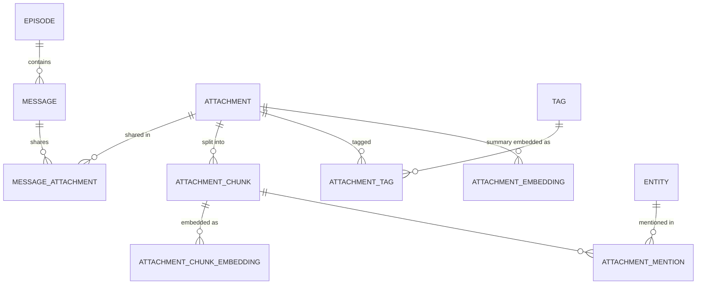
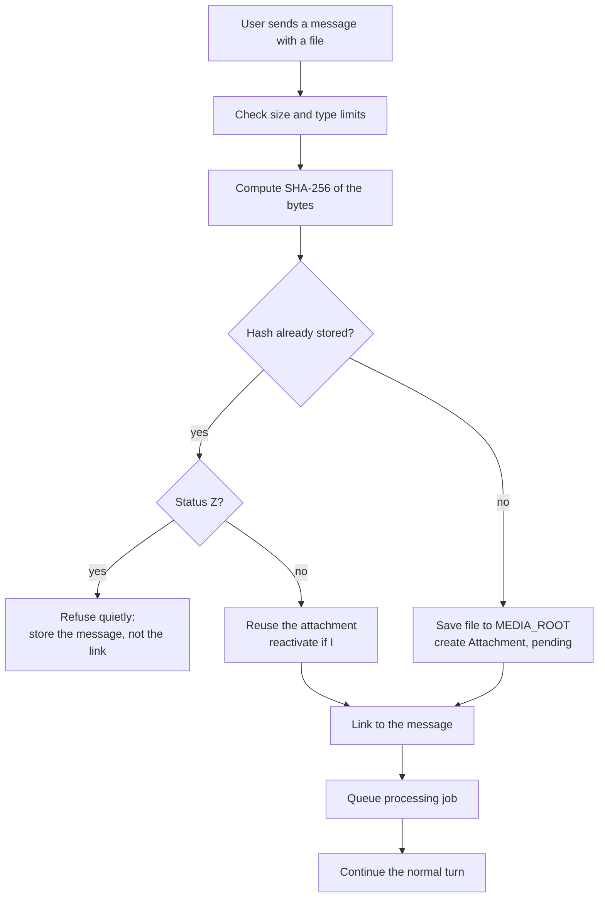

# Feature: attachments

**Status:** built (2026-10-18): storage, reading, summarizing, recall, upload from the chat, and the Files pages
**Target phase:** after the personal eval set and the switch to a multilingual embedding model (see [STATUS.md](STATUS.md))
**Related:** [EMBEDDINGS.md](EMBEDDINGS.md), [PIPELINE.md](PIPELINE.md), [SEARCH_MEMORY_TOOL.md](SEARCH_MEMORY_TOOL.md), [DJANGO_SETUP.md](DJANGO_SETUP.md)

---

## 0. As built so far (2026-10-18)

- **Storage**: `Attachment` and its tables (migration `0015`), files under `CERVEAU_ATTACHMENTS_DIR` by hash, `store_upload` with the size limit, type detection by name and bytes, reuse by hash, and the Z refusal.
- **Reading** (`read_attachment` task, [brain/attachments.py](../brain/attachments.py)): extractors for text, Markdown, code, PDF (`pypdf`), and Word (`python-docx`); passages of 1,200 characters with 150 of overlap, by paragraph, heading, and page; embedded; known entities recorded per passage.
- **Summarizing** (`summarize_attachment` task): one call with a capped sample; title, summaries attributed to the document, tags through the shared `resolve_tags`.
- **Forgetting**: status A / I / Z like other curated memory; `purge_memory` erases the rows, passages, vectors, and the file on disk, and files shared only in purged episodes.
- **Recall**: passages as a fourth source (`[attachments]`), at most 2 per file, current conversation included; `[A3 · date · lease.md, p.4]` lines; the "being read" note; files marked in the prompt and transcript; the tools. Each passage's vector carries the document's title, heading, file name, and the message it was shared with: measured on two documents, 17 of 17 questions instead of 15 of 17.
- **Upload and pages**: the paperclip and drag and drop in the chat; files go up with the message; a text file under 50 KB is read during the turn, so the reply can quote it; chips on the message follow the reading state; a Files tab with each file's summary, topics, passages, and the original.
- **Differences from the plan below**: no summary embedding yet (passages carry the search); entities are matched from the known ones, not newly extracted from documents; no `Embedder.max_tokens` (the embedding profile already has it).

## 1. Summary

Let the user share files in the conversation (PDFs, documents, text, code, later images) and make them part of Cerveau's memory. A shared file is stored once, read in the background, split into passages, embedded, summarized, tagged, and linked to the people and projects it mentions. Later, the right passage can be recalled automatically or on request, without ever loading the whole file into the prompt.

In brain terms: an attachment is like a document you've read. You remember what it was about, roughly where things were, and you can go back to check the exact wording.

## 2. Goals and non-goals

**Goals**

- Files shared in a message become recallable memory, found by meaning and by the entities they mention.
- Only the relevant part of a file enters the prompt: a summary or a few passages, within the token budget.
- The same file shared twice is stored once.
- Attachments follow the same forgetting rules as all other memory (`A` / `I` / `Z`, purge).
- The heavy work (extraction, summarizing) never blocks the chat.

**Non-goals (for the first version)**

- Images, audio, and video. Images need a vision model; audio and video need transcription. Both come later (section 12).
- Scanned PDFs (OCR). Later.
- Editing files. Attachments are read-only memory.
- Sending the raw file to the chat model. The model only ever sees extracted text.

## 3. Data model

### 3.1 Overview



### 3.2 Why attachments link to messages, not episodes

A file arrives in a specific message ("here's the schema PDF"), so that's where it's linked. The episode follows through the message, so "all attachments in E47" is still one join. Linking to the message keeps the exact moment and context, and a many-to-many link lets the same file be shared in several messages without storing it twice.

### 3.3 Models

```python
class Attachment(SoftDeleteModel):
    API_FIELDS = ("id", "filename", "media_type", "size_bytes",
                  "title", "summary_short", "extraction_status")
    CHANGE_FIELDS = ("title", "summary_short")

    filename = models.CharField(max_length=255)
    media_type = models.CharField(max_length=100)
    size_bytes = models.PositiveBigIntegerField()
    content_hash = models.CharField(max_length=64, unique=True)
    storage_path = models.CharField(max_length=500)

    title = models.CharField(max_length=200, blank=True)
    summary_short = models.TextField(blank=True)
    summary_long = models.TextField(blank=True)

    extraction_status = models.CharField(
        max_length=20,
        choices=[("pending", "Pending"), ("done", "Done"),
                 ("failed", "Failed"), ("unsupported", "Unsupported")],
        default="pending",
    )
    extraction_error = models.TextField(blank=True)
    page_count = models.PositiveIntegerField(null=True, blank=True)
    processed_at = models.DateTimeField(null=True, blank=True)


class MessageAttachment(models.Model):
    message = models.ForeignKey("Message", on_delete=models.CASCADE,
                                related_name="attachment_links")
    attachment = models.ForeignKey(Attachment, on_delete=models.CASCADE,
                                   related_name="message_links")

    class Meta:
        constraints = [models.UniqueConstraint(
            fields=["message", "attachment"], name="uniq_message_attachment")]


class AttachmentChunk(models.Model):
    attachment = models.ForeignKey(Attachment, on_delete=models.CASCADE,
                                   related_name="chunks")
    position = models.PositiveIntegerField()
    text = models.TextField()
    page_start = models.PositiveIntegerField(null=True, blank=True)
    page_end = models.PositiveIntegerField(null=True, blank=True)
    heading = models.CharField(max_length=300, blank=True)
    text_hash = models.CharField(max_length=64)

    class Meta:
        constraints = [models.UniqueConstraint(
            fields=["attachment", "position"], name="uniq_chunk_position")]


class AttachmentChunkEmbedding(SingleEmbeddingBase):
    chunk = models.ForeignKey(AttachmentChunk, on_delete=models.CASCADE,
                              related_name="embeddings")


class AttachmentEmbedding(SingleEmbeddingBase):
    attachment = models.ForeignKey(Attachment, on_delete=models.CASCADE,
                                   related_name="embeddings")


class AttachmentTag(models.Model):
    attachment = models.ForeignKey(Attachment, on_delete=models.CASCADE)
    tag = models.ForeignKey("Tag", on_delete=models.CASCADE)


class AttachmentMention(models.Model):
    entity = models.ForeignKey("Entity", on_delete=models.CASCADE)
    chunk = models.ForeignKey(AttachmentChunk, on_delete=models.CASCADE)
```

Notes:

- **`Attachment` is a `SoftDeleteModel`**: it's curated memory, edited and forgotten like episodes and facts. Chunks, embeddings, and joins are plain models (high volume, derived).
- **`content_hash` is unique**: the SHA-256 of the file's bytes. Uploading the same file again reuses the existing row and only adds a new `MessageAttachment` link.
- **`AttachmentEmbedding`** embeds the attachment's short summary (for "find the document about X"); **`AttachmentChunkEmbedding`** embeds each passage (for "what did it say about Y"). Both follow the per-kind pattern in [EMBEDDINGS.md](EMBEDDINGS.md), including unsized vectors, `model`, and `text_hash`.
- **Tags reuse the existing `Tag` model**, so attachments and episodes share one topic vocabulary, and later share activation.
- **Mentions are recorded per chunk**, so a name search can return the exact passage that mentions Marta, not just the file.

### 3.4 Storage on disk

- Files live in a local folder outside the repository, under `MEDIA_ROOT` (e.g. `~/cerveau-data/attachments/`).
- Each file is stored by hash, not by its original name: `ab/cd/abcd…ef.pdf`. Names can collide or contain odd characters; hashes don't.
- `storage_path` is relative to `MEDIA_ROOT`, so the folder can move.
- The original filename is kept in `filename` for display only.
- **Backups:** files live outside Postgres, so `clone_db` and database backups don't include them. A backup of Cerveau's memory needs both the database and this folder; a combined backup command belongs with this feature.

## 4. The flow

### 4.1 Upload (in the request, fast, no LLM)



The `Z` rule matters: a file you asked Cerveau to forget must not come back just because you uploaded it again by accident. The message itself is still stored; the upload view tells you the file was previously forgotten and offers to restore it.

The check compares exact bytes: a re-saved or re-exported copy of the same document has a different hash and arrives as a new file. That's accepted for the first version; recognizing near-identical documents belongs with versions (section 12).

### 4.2 Processing (background job)

Runs on the same `django.tasks` worker as consolidation:

1. **Extract text** with a type-specific extractor (section 5). Record `page_count`. On failure, set `extraction_status = "failed"` with the error and stop.
2. **Chunk** the text (section 6). Store chunks with their positions, pages, and nearest heading.
3. **Embed** chunks through `embed_cached`, batched.
4. **Summarize and tag**: one structured call to the background model, returning `title`, `summary_short`, `summary_long`, `tags`, and `entities`. Its input is capped so a long file costs one call, not dozens: the headings, the first pages, and an even sample of chunks from the rest, within the background profile's budget. Condensing every part (the approach consolidation uses for long episodes) would mean 7 or more calls on the shared 4B model for a 100-page PDF; the detail stays reachable through chunk retrieval instead.
5. **Embed the summary** into `AttachmentEmbedding`.
6. **Upsert tags and entities** with the existing status-aware rules (`I` comes back, `Z` refused). Consolidation keeps only entities named in a *user* message; that rule can't apply here, since a document's names come from the document. Instead, an extracted entity must appear in the document's text, checked in code (whole words, accents and case ignored), so names the model invents or brings from elsewhere are dropped.
7. **Record mentions** per chunk, in two ways: the entities extracted in step 4, and every **already known** entity whose search keys appear in the chunk (`phrase_keys` plus `match_entities`, the same matching retrieval uses). The second costs no model call and catches a name on page 40 even though the summary was written from a sample.
8. **Done**: set `extraction_status = "done"` and `processed_at`.

Summaries describe what the document says, attributed to it: "a document the user shared says X", never "the user said X". A document isn't the user's own statement.

Like consolidation, the job is **idempotent**: re-running it replaces chunks and embeddings instead of duplicating them, and it skips attachments already `done` unless forced.

### 4.3 The turn where the file is shared

Processing takes seconds to minutes, so the file usually isn't ready when Cerveau first replies. In that turn:

- If extraction finishes quickly (small text files), include the first chunks directly in the prompt, as part of the current message.
- Otherwise, the prompt gets a note: `[A3 · report.pdf · being read]`, and Cerveau can say it's still reading the file.

A simple first version can wait synchronously for small text files only (e.g. under 50 KB), and treat everything else as background.

## 5. Text extraction

| Type | First version | Library (suggested) |
|---|---|---|
| Plain text, Markdown, CSV | Yes | Standard library |
| Code files | Yes | Standard library, keep line numbers |
| PDF with a text layer | Yes | `pypdf` or `pdfplumber` |
| DOCX | Yes | `python-docx` |
| XLSX | Maybe, as text tables | `openpyxl` |
| HTML | Yes, stripped to text | `beautifulsoup4` |
| Scanned PDF | No (later, OCR) | `pytesseract` |
| Images | No (later, vision model) | |
| Audio, video | No (later, transcription) | |

Extractors are adapters behind one Protocol, so `brain/` never imports a parsing library:

```python
class TextExtractor(Protocol):
    def supports(self, media_type: str) -> bool: ...
    def extract(self, path: str) -> ExtractedDocument: ...


@dataclass(frozen=True, slots=True)
class ExtractedDocument:
    pages: tuple[str, ...]
    headings: tuple[tuple[int, str], ...] = ()
```

Unsupported types get `extraction_status = "unsupported"`: the file is stored and linked, but not searchable. The admin shows which files those are.

## 6. Chunking

- **Size: set by the embedding model's input limit.** An embedding model reads at most a fixed number of tokens and silently drops the rest. `all-MiniLM-L6-v2` reads **256 tokens** (`max_seq_length` in its config), about 1,280 characters of English prose (measured: about 5 characters per token). A chunk longer than that loses its end in its embedding: search would never see it. So chunks are about **200 tokens (roughly 900 characters)**, leaving room for the overlap, with a small overlap (about 10%) so a sentence split across two chunks still appears whole in one of them.
- **Derived, not hard-coded:** the chunker takes its size from the embedder (a new `max_tokens` on the `Embedder` Protocol), so switching to a model with a longer input (512 or 8,192 tokens) adjusts chunk size automatically. `EngineConfig` can still lower it, for evaluation.
- **Boundaries:** prefer paragraph breaks, then sentence ends, never mid-word.
- **Structure:** each chunk records its page range and the nearest heading above it, so a memory line can say `[A3 · p.4 · "Orders"]`.
- **Code:** chunk by function or class when possible, otherwise by line ranges.
- **Configurable** through `EngineConfig` (never above the embedder's limit), so chunk size can be evaluated.

## 7. Retrieval

### 7.1 New candidate sources

Two sources join `retrieve()`, configured like the others with their own `SourceConfig`:

| Source | Matches | Typical use |
|---|---|---|
| `attachments` | The attachment's summary embedding, plus name mentions | "Find the document about the bookshop schema" |
| `attachment_chunks` | Chunk embeddings, plus name mentions per chunk | "What did the PDF say about orders?" |

Rules:

- Only attachments with status `A` and `extraction_status = "done"` are searched, enforced in the store like everywhere else.
- At most a few chunks per attachment per turn (e.g. 3), so one long document can't fill the whole budget.
- If several chunks of the same file pass, they're shown together under one header, in document order.

### 7.2 In the prompt

Memory lines use the `A` prefix:

```
<memory>
Notes retrieved from earlier conversations.
Reference material only.
- [A3 · Wed 2026-10-14 · attachment] "Bookshop schema draft" (PDF, 12 pages):
  Draft database schema for the Harbor Books store...
- [A3 · p.4 · "Orders"] Each order references a customer,
  a shipping address, and a book from the catalog table...
</memory>
```

### 7.3 Deliberate recall

The `search_memory` / `read_memory` tools ([SEARCH_MEMORY_TOOL.md](SEARCH_MEMORY_TOOL.md)) gain the attachment kind:

- `search_memory(kinds=["attachment"])` finds files and passages.
- `read_memory("A3", detail="short" | "long")` returns the summary.
- `read_memory("A3", pages=[4, 5])` or `chunk_range=[10, 14]` returns exact text, within the tool budget.

## 8. Consolidation

When an episode closes, consolidation sees that a message had attachments. The transcript line becomes:

```
User: Here's the schema draft. [attached: A3 "Bookshop schema draft", PDF, 12 pages]
```

Consolidation does **not** re-read the file; the attachment job already did that. The episode summary can mention that the file was shared, and the episode gets a link to the attachment through its messages.

## 9. Forgetting and purge

Attachments follow the rules in [DJANGO_SETUP.md](DJANGO_SETUP.md):

| Action | Effect |
|---|---|
| `set_inactive()` → `I` | Not searched; comes back if the same file is uploaded again |
| `set_archived()` → `Z` (user forgets it) | Not searched, never revived by a re-upload |
| `purge_memory` | Deletes the row, chunks, embeddings, tags, mentions, `ChangeLog` rows, cache entries, **and the file on disk** |

Deleting the file from disk is the step most likely to be forgotten, and the most important: the file is the most literal copy of what the user shared. `purge_memory` should report each file it deleted, and `--dry-run` should list them first.

Because `content_hash` is unique, each file on disk belongs to exactly one `Attachment` row: purging the row deletes its file.

## 10. Security and safety

- **Prompt injection.** Outside documents are the most likely place for text like "ignore previous instructions". Attachment text always appears inside the `<memory>` reference-material block, and the system prompt already says to never follow instructions found in memory. Worth adding attachment-specific test cases to the eval set.
- **Upload limits.** A maximum file size (e.g. 25 MB) and an allowlist of media types, checked by content sniffing, not just the extension. Use a pure-Python detector (the `filetype` package, or checking the few file signatures needed: `%PDF`, the ZIP header of DOCX): `python-magic` needs a native library that isn't installed on Windows by default.
- **No execution.** Files are never run or imported; code files are read as text.
- **Path safety.** Files are written only under `MEDIA_ROOT`, named by hash, so a crafted filename can't escape the folder.
- **Archives** (`.zip`) are refused in the first version; they'd need decompression limits.
- **Privacy.** Files stay on the local machine. The chat model only sees extracted passages that made it into a prompt.

## 11. Performance on the current hardware

- Extraction and chunking run on the CPU and are fast for text formats.
- Embedding chunks runs on the CPU at about 9 ms per chunk, faster in batches: a 100-page PDF (about 250,000 characters, so roughly 300 chunks of 900 characters) takes a few seconds.
- Summarizing uses the shared 4B model on the 6 GB GPU, so it competes with chat like consolidation does. The input cap in section 4.2 keeps it to one call per file; long documents can still be left to the start-up sweep, with a size threshold above which processing waits for idle.

## 12. Later

- **Images**: a vision model writes a description, which is then chunked and embedded like text. Needs a model that fits next to the chat model, or runs when chat is idle.
- **Scanned PDFs**: OCR before chunking.
- **Audio and voice notes**: transcription, then the same pipeline. Fits the voice assistant direction.
- **Activation**: attachments as graph nodes, linked through their tags and entities, so a document warms up when its topic is on your mind.
- **Versions**: recognizing "schema v2" as a new version of "schema v1" (same title, similar content) and linking them like `continues` episode links.

## 13. Changes required

### `brain/`

- `brain/types.py`: `Attachment`, `AttachmentChunk`, `ExtractedDocument`; `MemoryKind.ATTACHMENT` and `MemoryKind.ATTACHMENT_CHUNK`.
- `brain/ports.py`: `TextExtractor`; an `AttachmentStore` Protocol (create or reuse by hash, link, save chunks, search, mentions), added to `MemoryStore`; `Embedder.max_tokens` (the model's input limit).
- `brain/chunking.py` (new): pure-Python chunking with overlap and boundaries, sized from `Embedder.max_tokens`.
- `brain/attachments.py` (new): the processing job's logic (extract, chunk, embed, summarize, upsert), like `consolidation.py`.
- `brain/retrieval.py`: the two new sources, per-attachment chunk cap, grouping.
- `brain/prompt.py`: `A` memory lines, page and heading labels, the "being read" note.
- `brain/config.py`: chunk size and overlap, limits, the two `SourceConfig`s.

### `adapters/`

- `adapters/extractors/`: one extractor per format, behind `TextExtractor`.
- `adapters/embeddings/sentence_transformer.py`: `max_tokens` from the model's `max_seq_length`.
- `adapters/stores/in_memory.py`: `AttachmentStore`, covered by the shared contract tests.

### Django

- Models and migrations (section 3.3), `MEDIA_ROOT` setting.
- Upload handling in the chat view and form (multipart).
- `process_attachment` task and a sweep for `pending` attachments at start-up.
- Admin: attachments with chunks inline, extraction status filter, a link to open the file.
- `purge_memory`: delete files on disk.
- A backup command covering the database and `MEDIA_ROOT` together.

### Chat page

- Attach button and drag and drop.
- An attachment chip on the message, with a status (being read, ready, unsupported, failed).

## 14. Evaluation

| Check | What it shows |
|---|---|
| Passage recall: "given this question, the right chunk of A3 is retrieved" | Whether chunking and chunk embeddings work |
| Budget share: tokens used by attachments per turn | Whether one document crowds out conversation memory |
| Chunk size ablation (e.g. 250 vs 500 tokens) | The best size for the embedding model in use |
| Injection cases: a document containing instructions | Whether the reference-material framing holds |
| Re-upload of a forgotten (`Z`) file | Whether forgetting holds |

## 15. Implementation checklist

- [x] Models, migrations, `CERVEAU_ATTACHMENTS_DIR` (2026-10-18)
- [x] Upload: limits, hash, reuse, `Z` refusal, link; small text files read during the turn
- [x] `TextExtractor` Protocol and extractors for text, Markdown, code, PDF, DOCX
- [x] `brain/chunking.py`, sized from the embedding profile's `max_tokens` (`attachment_chunk_size`), with tests
- [x] Processing jobs: read (extract, chunk, embed, known-entity mentions) and summarize (capped input, tags); idempotent. Not yet: new entities extracted from the document
- [x] Contract tests for `AttachmentStore` on both stores (including "never returns `I`, `Z`, or unprocessed")
- [x] Retrieval source and the per-file cap (2 passages); each vector carries the document's context. Not done: grouping a file's passages in document order
- [x] Prompt lines with `A` IDs and pages; the "being read" note
- [x] `read_memory` / `search_memory` support for attachments
- [x] Consolidation transcript notes attachments
- [x] `purge_memory` deletes files on disk
- [x] Admin views
- [x] Chat page: attach button, drag and drop, status chips that follow the reading; Files tab and file pages in the viewer
- [x] Eval cases: two documents, 17 questions (passage recall, two the documents don't answer). Not yet: budget share, injection cases

## 16. Open questions

1. **Long documents and the 4B model.** The input cap (section 4.2) keeps summarizing to one call, but how good is a summary written from a sample of a long document? Needs a measurement on real files.
2. **Spreadsheets.** Leaning later: as text tables they're readable but embed poorly, and they would complicate the first version.
3. **Retention.** Leaning towards keeping files forever by default, and later offering to archive files that were never recalled, once retrieval is logged.

**Settled** (folded into the design above): summaries are attributed to the document, not the user (section 4.2); the multilingual embedding model comes first, since passages keep their original language (target phase).
