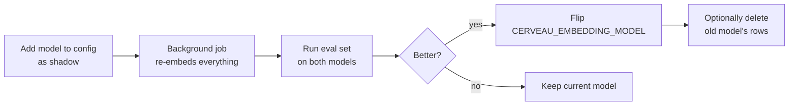

# Embedding storage

How Cerveau stores embeddings: in separate tables, one per kind of memory, so several embedding models can coexist without touching the content tables.

**Status:** design decided, not yet implemented.
**Supersedes:** the inline `embedding` / `summary_embedding` / `embedding_model` columns in the [architecture's schema](ARCHITECTURE.md#database-schema). Content tables no longer carry vectors.
**Related:** [PIPELINE.md](PIPELINE.md) steps 1, 4, and 6, and [DJANGO_SETUP.md](DJANGO_SETUP.md).

---

## 1. Why separate tables

With an `embedding` column on each content table, you can only have one embedding model at a time. Changing models means rewriting every row and losing the old vectors.

Moving vectors into their own tables gives you:

- **Several models side by side.** Embed everything with a new model while the current one keeps serving the assistant.
- **A/B comparisons.** Run the personal eval set and LoCoMo against both models on the same data, then decide.
- **Gradual migrations.** Re-embed in the background, switch with one config change, and roll back the same way.
- **Clean content tables.** `episodes`, `facts`, and the rest hold content and status only, so the admin and `ChangeLog` snapshots stay free of vectors.

## 2. Per-kind tables, not one polymorphic table

Two designs were considered:

| | Per-kind tables (chosen) | One table with `owner_type` + `owner_id` |
|---|---|---|
| Foreign keys | Real FKs to the source row | No FK possible |
| Purge and cascade | `ON DELETE CASCADE` handles it | Manual cleanup, risk of orphans |
| Active-only filtering | Simple join to the source's `status` | Join depends on `owner_type` |
| Number of tables | One per kind (~6) | One |
| Code duplication | None, via an abstract Django model | None |

**The deciding factor is forgetting.** `purge_memory` must leave no copies behind, and embeddings are derived copies of content (text can be partially reconstructed from embeddings, so they count as personal data). With real foreign keys, hard-deleting a fact removes its embeddings automatically. With a polymorphic table, that becomes a rule someone has to remember, which is the same weakness the activation table has.

## 3. The tables

| Table | Source | Embedded text | Shape |
|---|---|---|---|
| `EpisodeEmbedding` | `Episode` | Short summary, long summary | One row per episode per model, two vector columns |
| `MessageEmbedding` | `Message` | Message content | One row per message per model |
| `FactEmbedding` | `Fact` | Statement | One row per fact per model |
| `EntityEmbedding` | `Entity` | Name plus short description | One row per entity per model |
| `TagEmbedding` | `Tag` | Tag name | One row per tag per model |
| `SkillEmbedding` | `Skill` | Description | One row per skill per model |

`EmbeddingCache` stays as it is: a lookup from `(model, text_hash)` to vector, independent of any memory row (see [section 7](#7-relation-to-the-embedding-cache)).

## 4. Models

### 4.1 Single-text kinds: an abstract base

Messages, facts, entities, tags, and skills each embed one text. They share an abstract base:

```python
from django.db import models
from pgvector.django import VectorField


class SingleEmbeddingBase(models.Model):
    model = models.CharField(max_length=100)
    embedding = VectorField()
    text_hash = models.CharField(max_length=64)
    created_at = models.DateTimeField(auto_now_add=True)

    class Meta:
        abstract = True


class FactEmbedding(SingleEmbeddingBase):
    fact = models.ForeignKey(
        "Fact", on_delete=models.CASCADE, related_name="embeddings"
    )

    class Meta:
        constraints = [
            models.UniqueConstraint(fields=["fact", "model"], name="uniq_fact_emb")
        ]
```

`MessageEmbedding`, `EntityEmbedding`, `TagEmbedding`, and `SkillEmbedding` follow the same pattern with their own foreign key and constraint name.

These are plain `models.Model` subclasses, never `SoftDeleteModel`: they change often and must not write `ChangeLog` snapshots.

### 4.2 Episodes: two vectors per row

An episode has a fixed, known set of embeddable texts, so each one gets its own column:

```python
class EpisodeEmbedding(models.Model):
    episode = models.ForeignKey(
        "Episode", on_delete=models.CASCADE, related_name="embeddings"
    )
    model = models.CharField(max_length=100)
    summary_short = VectorField(null=True)
    summary_short_hash = models.CharField(max_length=64, blank=True)
    summary_long = VectorField(null=True)
    summary_long_hash = models.CharField(max_length=64, blank=True)
    created_at = models.DateTimeField(auto_now_add=True)
    updated_at = models.DateTimeField(auto_now=True)

    class Meta:
        constraints = [
            models.UniqueConstraint(
                fields=["episode", "model"], name="uniq_episode_model"
            )
        ]
```

- **One hash per vector.** Short and long summaries are rewritten independently, so each needs its own staleness check.
- **Nullable vectors.** The long summary may be written after the short one, or an experiment may embed only one of them.
- **Search uses both.** A query is compared against both summaries and the episode keeps the better similarity: the short summary matches broad queries, the long one matches specific details. In the contract, `save_summary` takes `short_embedding` and `long_embedding`.
- **Trade-off:** adding a third embeddable text later (for example the title) means a new column. For episodes, that's an acceptable price for simpler queries.

## 5. Columns explained

| Column | Purpose |
|---|---|
| `model` | Which embedding model produced the vector. Every query filters on it |
| `embedding` / `summary_short` / `summary_long` | The vector, stored as an unsized pgvector `vector` |
| `text_hash` / `*_hash` | `sha256` of the exact text that was embedded. Detects stale vectors |
| `created_at` / `updated_at` | When the vector was written. Useful for re-embed jobs |

### 5.1 Why `VectorField()` has no `dimensions`

Leaving out `dimensions` creates an unsized `vector` column, which accepts vectors of any length. That's what lets a 384-dimension model and a 768-dimension model share one table. Results stay correct because every query filters on `model`, so only vectors from the same model, and of the same length, are ever compared.

### 5.2 Staleness with `text_hash`

When consolidation rewrites a summary, the stored hash no longer matches the hash of the new text. Both helpers live in [brain/hashing.py](../brain/hashing.py), the single definition shared with the embedding cache:

```python
def text_hash(text: str) -> str:
    return hashlib.sha256(text.strip().encode("utf-8")).hexdigest()


def is_stale(stored_hash: str, current_text: str) -> bool:
    return stored_hash != text_hash(current_text)
```

The hash is computed in `brain/` when the text is embedded and travels with the vector as `Embedding.text_hash`, so stores save it without knowing how it was made.

A re-embed job finds stale rows, embeds the new text, and updates the vector and hash together. A stale vector should never be used for retrieval; until it's refreshed, the store either skips it or the job runs before the next search, depending on what's simpler to build.

## 6. Indexing

An HNSW index needs a fixed dimension, and an unsized column doesn't provide one. There are three options:

| Option | Speed | Flexibility | When |
|---|---|---|---|
| **No index** | Sequential scan | Any model | **v1.** Thousands of rows scan in milliseconds |
| **Partial expression index per model** | Fast | Any model, one small migration per model | When searches get slow |
| **Sized column (`VECTOR(384)`)** | Fast, simplest index | Every model must be 384 dimensions | Not chosen |

**Decision: no index in v1.** At personal scale, a sequential scan over a few thousand episodes or facts is fast. Messages grow fastest, so they'll likely be the first table to need an index.

When that happens, add a partial expression index per model:

```sql
CREATE INDEX message_emb_minilm_ml
ON cerveau_messageembedding
USING hnsw ((embedding::vector(384)) vector_cosine_ops)
WHERE model = 'paraphrase-multilingual-MiniLM-L12-v2';
```

**Queries must match the index exactly**, using the same cast and the same `WHERE model = ...`, or Postgres ignores the index:

```sql
SELECT message_id
FROM cerveau_messageembedding
WHERE model = 'paraphrase-multilingual-MiniLM-L12-v2'
ORDER BY embedding::vector(384) <=> %s::vector(384)
LIMIT 20;
```

In Django, the ORM query must apply the same cast, for example `CosineDistance(Cast("embedding", VectorField(dimensions=384)), query)`, filtered on the same `model`; a plain `CosineDistance("embedding", query)` will not use the index.

Adding a model with an index is then a migration that creates one index, never a column change.

## 7. Relation to the embedding cache

The two serve different purposes:

| | `EmbeddingCache` | `*Embedding` tables |
|---|---|---|
| Key | `(model, text_hash)` | The memory row + `model` |
| Purpose | Never embed the same text twice | Search memories by meaning |
| Lifetime | Disposable, can be cleared any time | Must stay in sync with content |

The flow when a memory needs a vector:

1. Compute `text_hash`.
2. Look up `(model, text_hash)` in `EmbeddingCache`. On a miss, call the `Embedder` and store the result.
3. Write the vector and hash to the memory's embedding row.

When a forgotten memory is purged, the whole cache goes (see [section 10](#10-forgetting-and-purge)), since they hold vectors derived from its text.

## 8. Which model is live

The active model is a setting, not data:

```ini
# .env
CERVEAU_EMBEDDING_MODEL=bge-m3   # a profile in configs/embeddings/
```

- **Retrieval always filters on the live model.** Rows from other models are shadows: kept, searchable by eval jobs, invisible to the assistant.
- **The engine decides which space it searches.** The query is an `Embedding`, which carries its model name, so every search names its space and `brain/` stays in charge ([brain/ports.py](../brain/ports.py)):

```python
class SearchStore(Protocol):
    def semantic_candidates(
        self, kind: MemoryKind, query: Embedding, limit: int
    ) -> list[Candidate]: ...
```

- **Missing vectors.** A memory without a vector for the live model is invisible to semantic search but still reachable through lexical and graph signals. Re-embed jobs close that gap.

### 8.1 Model choice

The current default is `bge-m3` (1024 dimensions, multilingual, reads up to 8,192 tokens), served by Ollama. It replaced `all-MiniLM-L6-v2` (384 dimensions, English) on 2026-10-17 after a comparison of five models on the eval set (`python -m evals`; results in [STATUS.md](STATUS.md#evals-evals)). The switch was exactly what this design promised: a background re-embed (`embed_memory`) plus a config change, with nothing to migrate. Each model has a profile in `configs/embeddings/` carrying its own retrieval threshold, since thresholds only mean something for the model they were measured on.

## 9. Switching models



1. **Embed with the new model** in the background, writing new rows alongside the existing ones.
2. **Calibrate thresholds.** Similarity thresholds (drift, fact dedup, tag matching) are model-specific and must be re-tuned for the new model.
3. **Evaluate both** on the personal eval set and, later, LoCoMo.
4. **Flip the config** if the new model wins. Rolling back is flipping it back.
5. **Clean up** the old model's rows once you're confident, or keep them for comparison.

A management command keeps this repeatable:

```bash
python manage.py embed_memory --model paraphrase-multilingual-MiniLM-L12-v2 --kinds episode fact entity tag
python manage.py embed_memory --model all-MiniLM-L6-v2 --stale-only
python manage.py drop_embeddings --model all-MiniLM-L6-v2 --dry-run
```

## 10. Forgetting and purge

| Action | Effect on embeddings |
|---|---|
| Memory set to `I` or `Z` | Rows stay, but the store never returns them: semantic search joins to the source and filters `status = 'A'` |
| Fact superseded | Rows stay, excluded by `superseded_by IS NULL` |
| Memory hard-deleted by `purge_memory` | `ON DELETE CASCADE` removes all its embedding rows, for every model |
| Purge, related cache | `purge_memory` empties the whole `EmbeddingCache` (since 2026-11-09; before, only the entries matching purged texts by hash): some cached texts are stored nowhere else (the model's search queries, searches typed on the memory page), so their entries can't be matched to what was purged. The cache only saves time; a text needed again is embedded again |

The active-only rule from [DJANGO_SETUP.md](DJANGO_SETUP.md) applies here too: every semantic search joins the embedding table to its source table and filters on the source's status, so inactive and forgotten memories never come back from vector search.

```python
FactEmbedding.objects.filter(
    model=live_model,
    fact__status="A",
    fact__superseded_by__isnull=True,
)
```

## 11. Store responsibilities

- **The engine embeds; stores only save and compare vectors** (decision already in effect, see [STATUS.md](STATUS.md)). Every `Embedding` a store receives carries `model` and `text_hash`.
- Both `InMemoryStore` and `DjangoMemoryStore` implement the same embedding methods, covered by the shared contract tests, including:
  - Search only returns vectors for the requested model.
  - Search never returns inactive, forgotten, or superseded memories.
  - Writing an embedding for an existing `(memory, model)` pair updates it instead of duplicating it.
  - Stale vectors (hash mismatch) are detectable.

## 12. Implementation checklist

- [ ] Remove inline embedding columns from the content models (they don't exist yet in code, so only the README schema changes)
- [ ] `SingleEmbeddingBase` and the five single-text embedding models (done: base and `MessageEmbedding`; fact, entity, tag, skill come with their kinds)
- [x] `EpisodeEmbedding` with two vectors and two hashes
- [x] `text_hash` helper shared by the cache and the embedding tables ([brain/hashing.py](../brain/hashing.py))
- [x] Search names its embedding space (`query: Embedding` carries the model)
- [x] `Embedding` carries `text_hash`; `save_summary` takes both summary embeddings
- [ ] Store methods for re-embed jobs: list rows missing or stale for a model, write one row's embedding
- [ ] Contract tests for the rules in section 11 (done: same-model search, active-only, upsert per `(memory, model)`; staleness detection pending)
- [ ] `embed_memory` and `drop_embeddings` management commands (done: `embed_memory` for messages; episodes, `--stale-only`, and `drop_embeddings` pending)
- [ ] `purge_memory` cleans `EmbeddingCache` entries
- [ ] Test the multilingual model on the eval set
- [ ] Partial HNSW index on `MessageEmbedding` once searches slow down

## 13. Open questions

1. **Entity text.** Embed the name alone, or the name plus a short description? Names alone embed poorly; descriptions need to be written at consolidation.
2. **Stale-vector policy.** Skip stale vectors during search, or block search on a refresh? Skipping is simpler; blocking is more accurate right after consolidation.
3. **Message embeddings for assistant replies.** Embed both roles, or user messages only? Assistant replies are long and may add noise to drift detection.
4. **Old model cleanup.** Keep one previous model's vectors as a baseline, or drop them after a switch?
