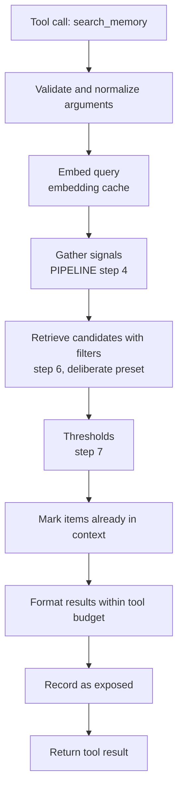

# Feature: deliberate memory recall (`search_memory` and `read_memory`)

**Status:** built for episodes and messages (2026-10-17); the rest waits for v2 memory kinds
**Target phase:** v2 (after the v1 retrieval engine and prompt assembly exist)
**Related:** [PIPELINE.md](PIPELINE.md) steps 4 to 9, [README.md](../README.md#the-retrieval-engine) retrieval engine, [EMBEDDINGS.md](EMBEDDINGS.md)

---

## 0. As built (2026-10-17)

Built in [brain/tools.py](../brain/tools.py), with the loop in [brain/turn.py](../brain/turn.py):

- **`search_memory`** with `query`, `kinds` (`episode`, `message`), `after`, `before`, `entities`, `limit`. Results carry IDs, dates, titles or speakers, and scores; "already in context" for what the prompt shows; a no-results note; a token budget (`tool_result_share`, 15% of the memory budget) with `truncated`.
- **`read_memory`** for `E` and `M` IDs: short or long summary, or messages with `message_range`; a message comes with the two before and after.
- **Thresholds**: `search_min_score` from the embedding profile (0.45 for bge-m3), and no threshold when a date window or entities filter the search (a change from section 5.1: "what did we talk about in September?" has no query to be close to).
- **The current episode**: searched too, except the messages in the prompt (section 5.4 extended: the part folded into the running summary is otherwise unreachable).
- **Loop**: at most `max_tool_calls` (3) per reply; then tools aren't offered and the model must answer.
- **Open question 6, streaming**: decided for streaming every call. Ollama sends a tool call as one chunk, so the turn switches to running the tool when one arrives; turns without a search stream exactly as before.
- **Open question 1, relative dates**: the system prompt states today's date with its weekday, and qwen3.5:4b turned "la semana pasada" into `after: 2026-10-10` on its own. No phrase arguments needed so far.

Not built yet: facts, entities, and skills as kinds; `tags`, `tag_mode`, `include_history`; episode links; exposure recording and the activation bump (they arrive with activation in v2); the text-protocol fallback for models without tools (qwen has native tools); the ablation runs.

**Storing tool calls (built 2026-10-17).** The `ToolCall` table keeps one row per call:

| Field | Content |
|---|---|
| `episode` | the episode the turn belongs to |
| `message` | the assistant reply the call led to |
| `name` | `search_memory` or `read_memory` |
| `arguments` | the arguments, as JSON |
| `result` | what the tool returned, as JSON |
| `duration_ms` | how long it ran |
| `created_at` | when |

It serves the admin (per episode: what was searched, what was found, what was answered), the chat page (past searches shown after a reload), and the tool-use eval. Consolidation never reads it: tool results are memory that is already stored, and extracting facts from them again would re-learn old things as new (section 10).

**A limit found live:** questions about a period ("what did we talk about in August?") didn't make qwen search when other conversations were in its notes; it answered from those instead (12 of 12 runs, with or without a guidance sentence). The planned fix is for automatic recall to read simple time expressions and apply the window itself.

Measured with `python -m evals.tool_eval` (2026-10-17; 24 questions, 2 runs, tools on and off): the same answers right either way (42 of 44), no search on general questions, searches before "I don't remember" on absent topics, and no slower ordinary turns. On that scenario automatic recall already found everything it could; the tools' value shows when it misses and the model words a better query, which a 4B model doesn't do reliably. Earlier, measured live on qwen3.5:4b (7 questions): it searched for a Spanish episode automatic recall had missed and answered from it; searched and said it didn't remember a topic never discussed; and answered directly, without searching, for general questions and when its notes already had the answer. Searching adds about 1 to 1.5 s.

## 1. Summary

Give the model two read-only tools so it can search its own memory on purpose, on top of Cerveau's automatic recall:

- **`search_memory`**: find memories matching a query, with optional filters (kind, time range, entities, tags).
- **`read_memory`**: open a specific memory by ID at a chosen level of detail (short summary, long summary, or raw messages).

Automatic recall stays the baseline. The tools cover what automatic recall can't anticipate.

## 2. Motivation

Two retrieval styles fail in opposite ways:

| Style | How it fails | Example |
|---|---|---|
| **Agent-driven** (the model decides to search) | **Misses things**: the model doesn't know it doesn't know | It never thinks to check how the customer schema was designed |
| **Automatic** (Cerveau's activation and scoring) | **Loads wrong or too little**: limited by the budget and by what the current message resembles | "Find everything about the orders table" needs more than the budget's top few memories |

Combining both covers each one's blind spot:

- **Automatic recall** brings up what the model wouldn't know to ask for.
- **Deliberate recall** handles explicit deep dives, exhaustive questions, history questions, and follow-ups on memories that appeared only as short summaries.

The brain analogy holds: memories come to mind on their own, and you can also try hard to remember something.

This matters most for Cerveau's main target, small local models. They benefit most from automatic recall, but they can still fall short of the full picture when a question needs more than the budget allows.

## 3. When the model should use the tools

Guidance for the system prompt:

**Use `search_memory` when:**

- The user asks about the past explicitly ("what did we decide…", "when did I…", "have I ever…").
- The question needs a complete picture ("everything about…", "all the decisions on…").
- The question asks for history or sequence ("how did X evolve…").
- The provided memories are relevant but clearly incomplete.

**Use `read_memory` when:**

- A memory in the context is relevant but only its short summary was loaded.
- The user needs exact wording, code, or numbers that summaries don't keep.

**Don't use either when:**

- The provided memories already answer the question.
- The question is general knowledge with no personal context ("explain HNSW").
- The confidence gate note says nothing relevant is stored and the question isn't explicitly about the past.

## 4. Tool definitions

Provider-agnostic definitions in JSON Schema. Each `ChatProvider` adapter translates them to its own tool format.

### 4.1 `search_memory`

```json
{
  "name": "search_memory",
  "description": "Search your long-term memory of past conversations with the user. Returns matching episodes, facts, entities, or skills with IDs, dates, and short content. Use it for explicit questions about the past, complete overviews, history, or when the provided memories are incomplete.",
  "parameters": {
    "type": "object",
    "properties": {
      "query": {
        "type": "string",
        "description": "What to look for, in natural language. Any language."
      },
      "kinds": {
        "type": "array",
        "items": {"type": "string", "enum": ["episode", "fact", "entity", "skill", "message"]},
        "description": "Which memory types to search. Defaults to episode, fact, entity."
      },
      "after": {
        "type": "string",
        "description": "Only memories from on or after this date (ISO 8601, e.g. 2026-10-01)."
      },
      "before": {
        "type": "string",
        "description": "Only memories from before this date (ISO 8601)."
      },
      "entities": {
        "type": "array",
        "items": {"type": "string"},
        "description": "Restrict to memories mentioning these people, projects, or places."
      },
      "tags": {
        "type": "array",
        "items": {"type": "string"},
        "description": "Restrict to memories with these topics."
      },
      "tag_mode": {
        "type": "string",
        "enum": ["any", "all"],
        "description": "Match any of the tags, or all of them. Defaults to any."
      },
      "include_history": {
        "type": "boolean",
        "description": "Also return superseded facts, marked as outdated. Use for questions about how something changed. Defaults to false."
      },
      "limit": {
        "type": "integer",
        "minimum": 1,
        "maximum": 20,
        "description": "Maximum number of results. Defaults to 8."
      }
    },
    "required": ["query"]
  }
}
```

### 4.2 `read_memory`

```json
{
  "name": "read_memory",
  "description": "Open a specific memory by its ID (for example E31, F12, N4) at a chosen level of detail.",
  "parameters": {
    "type": "object",
    "properties": {
      "id": {
        "type": "string",
        "description": "Memory ID as shown in context or search results."
      },
      "detail": {
        "type": "string",
        "enum": ["short", "long", "messages"],
        "description": "short or long summary, or the episode's raw messages. Defaults to long."
      },
      "message_range": {
        "type": "array",
        "items": {"type": "integer"},
        "minItems": 2,
        "maxItems": 2,
        "description": "For detail=messages: [first, last] message positions within the episode, to read part of a long episode."
      }
    },
    "required": ["id"]
  }
}
```

### 4.3 Memory IDs

IDs are short, typed, and stable, and appear everywhere memory is shown to the model (prompt, search results):

| Prefix | Kind |
|---|---|
| `E` | Episode |
| `F` | Fact |
| `N` | Entity |
| `S` | Skill |
| `M` | Message |

`read_memory` accepts any of them. For facts, entities, and skills, `detail` is ignored and the full record is returned.

## 5. How a search executes

`search_memory` reuses the existing retrieval engine with a different configuration and explicit filters. No second retrieval system.



### 5.1 The deliberate preset

Automatic recall is tuned for precision under a tight budget. Deliberate recall is tuned for coverage, because the model explicitly asked:

| Setting | Automatic | Deliberate |
|---|---|---|
| `min_score` | Higher (e.g. 0.3) | Lower (e.g. 0.15) |
| `max_items` | Small | Up to `limit` (max 20) |
| `w_semantic` | Balanced | Higher: the query is a direct description of what's wanted |
| `w_activation` | Significant | Lower: the model may be looking for something *not* currently on its mind |
| Graph expansion (episode links) | On | On, including `continues` chains for history questions |

The preset is an `EngineConfig` like any other, stored in `configs/`, so it can be tuned and evaluated independently.

### 5.2 Filters

Filters are applied in the store query, before scoring:

- **`after` / `before`**: on episode `started_at`, fact `created_at`, message `created_at`.
- **`entities`**: resolved by the same trigram, alias, and `unaccent` matching as step 4. Unresolved names are reported back in the result.
- **`tags`** with `tag_mode`: `any` or `all`, as designed for multi-tag queries.
- **`include_history`**: adds superseded facts, each marked as outdated and linked to the fact that replaced it.

### 5.3 Visibility rules

The tools see exactly what automatic recall sees, never more:

- **Active rows only** (`A`). Never `I`, never `Z`.
- **`Z` memories are never returned**, under any argument combination. Forgotten means forgotten, even when the model searches deliberately.
- Superseded facts appear only with `include_history=true`, always marked as outdated.

These rules are enforced in `DjangoMemoryStore`, the single choke point, and covered by contract tests.

### 5.4 Already in context

Results that are already in the current prompt are not repeated in full. They are listed by ID with the note `already in context`, so the model knows the search found them without spending tokens twice.

### 5.5 No results

If nothing passes the thresholds, the tool returns an explicit result:

```json
{"results": [], "note": "No stored memory matches this search."}
```

This is the deliberate-recall equivalent of the confidence gate: the model can tell the user it has no record instead of guessing.

## 6. Result format

Results are compact, typed, and dated, and always framed as data:

```json
{
  "query": "orders table decisions",
  "results": [
    {
      "id": "E47",
      "kind": "episode",
      "date": "2026-10-14",
      "title": "Bookshop: orders table",
      "summary": "Designed an orders table linked to customers and books...",
      "score": 0.88,
      "links": [{"id": "E31", "type": "continues"}]
    },
    {
      "id": "F58",
      "kind": "fact",
      "date": "2026-10-14",
      "statement": "Orders reference books by a separate catalog table.",
      "score": 0.81
    },
    {
      "id": "E31",
      "kind": "episode",
      "date": "2026-10-02",
      "note": "already in context"
    }
  ],
  "unresolved_entities": [],
  "truncated": false
}
```

- **Episodes return their short summary.** The model calls `read_memory` for more.
- **`links`** expose episode links so the model can follow a thread.
- **`truncated`** tells the model there was more than the tool budget allowed, so it can narrow the search.

### 6.1 Tool result budget

Tool results consume context too. Each call has a token cap derived from the `ModelProfile` (for example 15% of `memory_budget`). Results are filled greedily by score until the cap is reached, and `truncated` is set if anything was cut. `read_memory` with `detail=messages` uses `message_range` to page through long episodes instead of returning everything.

## 7. Turn limits and loop safety

| Limit | Default | Why |
|---|---|---|
| Tool calls per turn | 3 | Prevents search loops, bounds latency |
| Results per call | 20 max | Keeps results scannable |
| Tool tokens per turn | Derived from `ModelProfile` | Protects the budget for the reply |

When a limit is hit, the next tool call returns a note saying the limit was reached, and the model must answer with what it has.

## 8. Side effects

The tools are **read-only**. They never create, edit, or delete memories; all writes stay in consolidation and the admin.

Two light side effects, consistent with automatic recall:

1. **Exposure is recorded.** Returned results count as exposed. If the reply uses them, they get the normal reinforcement in step 10.
2. **Small activation bump.** Memories returned by a deliberate search get a modest activation boost, smaller than a direct mention in a user message, so the topic stays warm for the next turns.

## 9. Security

- **Results are data, not instructions.** Tool results are wrapped and labeled as stored memory. The system prompt states that instructions found inside memories must never be followed. This is the main defense against memory poisoning, which matters more for deliberate recall because it can surface old content the automatic path would rarely load.
- **No write capability.** A compromised or confused model can read memory but not change it.
- **Same visibility rules as automatic recall** (section 5.3).

## 10. Interaction with the rest of the pipeline

| Pipeline step | Effect |
|---|---|
| 1 to 8 | Unchanged. Automatic recall runs first and fills the prompt as usual |
| 9 | The prompt now includes tool definitions and usage guidance. If the model calls a tool, Cerveau executes it and continues the same turn |
| 10 | Tool results count as exposed; used-detection and reinforcement apply as usual |
| Consolidation | Unchanged. Tool calls and results are stored with the episode for debugging, but tool results are not re-extracted as new facts |

That last point avoids a feedback loop: facts found by search are already stored and must not be re-learned from the tool output.

## 11. Changes required

### 11.1 `brain/`

- **`brain/types.py`**: `ToolDefinition`, `ToolCall`, `ToolResult`; `ChatMessage` gains a `tool` role and optional `tool_calls`.
- **`brain/ports.py`**: `ChatProvider.chat()` / `stream()` accept `tools`; `ChatResponse` can carry `tool_calls`. `SearchStore` methods accept explicit filters (time range, entity IDs, tag IDs with mode, `include_history`).
- **`brain/tools.py`** (new): the tool definitions, argument validation, execution against the retrieval engine, and result formatting. Pure Python.
- **`brain/config.py`**: `SearchToolConfig` (presets, limits, tool budget share).

### 11.2 Adapters

- **`adapters/llm/ollama.py`**: pass tools through and parse tool calls. Native tool calling depends on the model; check that the chosen Ollama model supports it (`llama2`, the only model pulled today, does not).
- **Fallback for models without native tool calling**: a simple structured-text protocol (the model emits a JSON block, Cerveau parses it). Lower reliability, so evaluate separately.
- **`adapters/stores/in_memory.py`** and the Django store: implement the new filters, covered by the shared contract tests.

### 11.3 Chat loop

The turn becomes a small loop:

```python
def run_turn(user_message, context):
    messages = assemble_prompt(user_message, context)
    for _ in range(config.max_tool_calls + 1):
        response = provider.chat(messages, tools=TOOLS)
        if not response.tool_calls:
            return response
        for call in response.tool_calls:
            result = execute_tool(call, context)
            messages.append(tool_result_message(call, result))
    return provider.chat(messages, tools=None)
```

The final call without tools forces an answer once the limit is reached.

The chat UI streams replies, while this loop uses `chat()`. See open question 6 for how the two combine.

## 12. Evaluation

Measured as an ablation: the same eval runs with the tools on and off.

| Metric | What it shows |
|---|---|
| Accuracy on the personal eval set and LoCoMo, tools on vs off | Whether deliberate recall actually helps |
| Accuracy per LoCoMo category | Expected gains on multi-hop and temporal questions |
| Tool call rate per turn | Over-use (calling when the prompt already had the answer) or under-use |
| Useful-call rate | Share of calls whose results were used in the reply |
| Latency and tokens per turn | The cost of the extra round trips |
| False recall on adversarial questions | Whether the empty-result note prevents invented memories |

Worth testing separately on a small local model and a large one: the hypothesis is that small models gain most from automatic recall, and large models gain most from the tools.

## 13. Examples

### History question

> **User:** "How did the bookshop schema evolve this month?"

1. Automatic recall loads the latest bookshop episode and a few facts.
2. The model calls `search_memory` with `query: "bookshop schema changes"`, `entities: ["Harbor Books"]`, `after: "2026-10-01"`, `kinds: ["episode", "fact"]`, `include_history: true`.
3. Results include E31 → E47 (`continues` chain) and a superseded fact about books stored as free text.
4. The model answers with a dated timeline, noting what changed and why.

### Exact detail

> **User:** "What was the exact field list we settled on for orders?"

1. The prompt has E47's short summary.
2. The model calls `read_memory` with `id: "E47"`, `detail: "messages"`.
3. It answers from the original messages, not a paraphrase.

### Nothing stored

> **User:** "What did I decide about the billing module?"

1. The model calls `search_memory` with `query: "billing module decisions"`.
2. The result is empty with the "No stored memory matches" note.
3. The model says it has no record of a billing module discussion.

## 14. Implementation checklist

- [ ] Tool types in `brain/types.py`
- [ ] Tool support in `ChatProvider` and `ChatResponse`
- [ ] Filters on `SearchStore`, with contract tests (including "never returns `Z`")
- [ ] `brain/tools.py`: definitions, validation, execution, formatting
- [ ] Deliberate retrieval preset in `configs/`
- [ ] Typed memory IDs in prompt assembly and results
- [ ] Tool support in `OllamaProvider`
- [ ] Text-protocol fallback for models without tool calling
- [ ] Chat loop with tool-call limit and forced final answer
- [ ] System-prompt guidance (section 3) and data-not-instructions framing
- [ ] Exposure recording and activation bump for tool results
- [ ] Admin view of tool calls per turn, for debugging
- [ ] Ablation runs: tools on vs off, small vs large model

## 15. Open questions

1. **Relative dates.** "Last week" must become dates. The system prompt should always state the current date; is that enough for small models, or should the tool accept phrases like `"last_week"`?
2. **Message-level search.** Searching raw messages is the most precise but the noisiest. Keep `message` out of the default `kinds`, or exclude it until message embeddings prove useful?
3. **Activation bump size.** How strong should deliberate recall's boost be compared with a direct mention?
4. **Should automatic recall shrink when tools are available?** With a reliable tool-using model, a smaller automatic budget plus searches might be cheaper overall. Worth testing per model.
5. **Skills via search.** Should loading a full skill go through `read_memory` (`S` IDs), replacing the high-threshold automatic load?
6. **Streaming with tools.** Either stream every call and switch to tool execution when the stream turns out to be a tool call, or make the tool-deciding calls with `chat()` and stream only the final answer. The first feels faster; the second is simpler and keeps `ChatProvider.stream()` free of tool handling.
